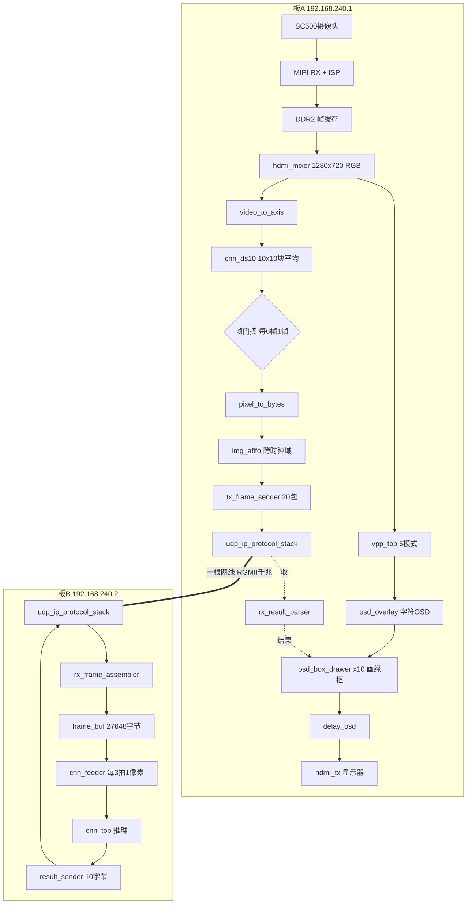
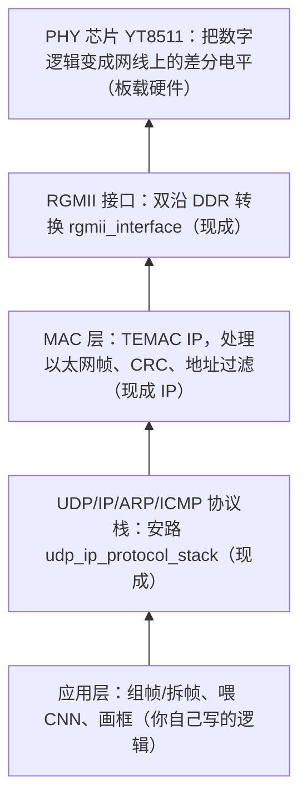

# HX1P35A 双板以太网级联实施指导

> **重要：这是早期的实施草案，不是可直接下载的完整工程。** 对照当前工作区后发现两份业务工程都没有实际以太网 RTL；官方 APUG013 UDP 参考设计已在 `board source/HX1P35A_Contest_202606/6_PH1P35数据手册/参考IP设计资料文档.zip` 的嵌套压缩包中找到，但它面向 `PH1A100SFG676` 旧板，不能直接下载到 HX1P35A。本文示例还包含未核对的引脚/PLL 假设、一个不存在的 `S_hdmi_out_pclk` 信号，以及不能用作单播源地址的 `01:...` MAC 示例。请不要按本文后续的精确代码和约束直接覆盖工程。
>
> 当前核验版路线见 [HX1P35A双板以太网落地路线.md](HX1P35A双板以太网落地路线.md)。本文剩余内容仅供回看早期设计思路；APUG013 可以作为 MAC/RGMII/UDP 的协议基础，但必须结合 HX1P35A 原理图重新制作引脚、时钟和时序约束后，才能逐项复用并验证。

> **阶段 0～阶段 1 的 RTL/工程移植已完成，但旧运行数据库和旧 bit 均不能作为当前验收结果。** 可直接打开的移植工程位于 `stage1_hx1p35a_udp/par_ph1demo/udp_demo.al`；已完成 APUG013 提取、PH1P35MDG324 目标设置、50 MHz PLL 修改、`.sdc` 时序约束，以及 `rgmii_interface.v` 中的 RXC 全局时钟缓冲。板卡技术人员确认 HX1P35A/B 电气连接和球位相同（差异仅为螺丝孔），因此当前 `.adc` 采用工作区 HX1P35B 原理图的 `ETHPHY_*` 网络映射。正式工程必须重新 Read Design、综合、布局布线并生成新的 bit，详见工程内 `stage1_hx1p35a_udp/README_STAGE1.md`；此前 `udp_demo_Runs/best_result/udp_demo.bit` 不可用于验收。

> 目标：把「MIPI 摄像头采集 + HDMI 显示主工程」部署到板 A，把「人脸识别 CNN 卷积网络」部署到板 B，两块 FPGA 板通过一根网线（千兆 RGMII + UDP）交互。
>
> 约定：**所有改动都在工程副本上进行，原始工程和备份不动。** 文档中每个需要新建/修改的文件都给出了完整内容和改动原因。

---

## 目录

- [0. 项目概览](#0-项目概览)
- [1. 基础知识：FPGA 上的以太网分几层](#1-基础知识fpga-上的以太网分几层)
- [2. 通信协议规格（两板共同约定）](#2-通信协议规格两板共同约定)
- [3. 硬件接线与引脚表](#3-硬件接线与引脚表)
- [4. 阶段 0：备份与准备](#4-阶段-0备份与准备)
- [5. 阶段 1：打通网络底层（最难的物理层）](#5-阶段-1打通网络底层最难的物理层)
- [6. 阶段 2：板 B 接入 CNN](#6-阶段-2板-b-接入-cnn)
- [7. 阶段 3：板 A 改造](#7-阶段-3板-a-改造)
- [8. 阶段 4：双板直连联调](#8-阶段-4双板直连联调)
- [9. 常见问题排查](#9-常见问题排查)
- [10. 最终交付检查清单](#10-最终交付检查清单)
- [附录 A：工程文件路径速查](#附录-a工程文件路径速查)

---

## 0. 项目概览

### 0.1 硬件清单

| 物品 | 说明 |
|---|---|
| HX1P35A 开发板 ×2 | FPGA 为安路 PH1P35MDG324（BGA324，38184 LUT / 42432 DFF / ERAM 2160Kbit / DSP 40） |
| 普通网线 ×1 | 直连接两块板 RJ45，PHY 支持 Auto-MDIX，**不需要交叉线** |
| Type-C 线 ×2 | 板载 AL-LINK-FT 下载器，分别连电脑（或轮流下载） |
| 12V/1A 电源 ×2（或 USB 供电） | 两块板独立供电 |
| SC500CS 摄像头 | 只接板 A 的 MIPI FPC40 接口 |
| HDMI 显示器 + HDMI 线 | 只接板 A |

### 0.2 任务划分

- **板 A（192.168.240.1）**：摄像头采集 → ISP → DDR2 → hdmi_mixer（正常彩色帧）→ 一路走 vpp/OSD → HDMI 显示；另一路降采样到 128×72，打包 UDP 发出；同时接收板 B 回传的人脸框，画到 HDMI 上。
- **板 B（192.168.240.2）**：接收 20 个 UDP 包拼成一帧 128×72 RGB，喂给 cnn_top 推理，把人脸框（10 字节小包）发回板 A。

### 0.3 整体架构



### 0.4 五阶段路线

| 阶段 | 内容 | 验收标准 |
|---|---|---|
| 0 | 备份、复制 UDP 参考设计 | 备份可打开，工程能打开且器件正确 |
| 1 | 参考设计改 HX1P35A 引脚/时钟，跑 UDP 回环 | 电脑 ping 通；网络助手发啥收啥 |
| 2 | 板 B 挂 cnn_top | 电脑发 128×72 测试图，收到人脸框 |
| 3 | 板 A 改造 | 电脑当板 B：收到 20 包图像；发假框能画到 HDMI |
| 4 | 双板网线直连 | 真人出镜，HDMI 绿框实时跟踪 |

---

## 1. 基础知识：FPGA 上的以太网分几层



几个关键概念：

- **PHY（YT8511）**：物理层芯片，旁边有独立 25MHz 晶振，FPGA 不需要给它供参考时钟。上电后通过 FPGA 拉低再释放 RESET_N 完成硬件复位，随后自协商（和对端商量速度/双工）。
- **RGMII**：FPGA 与 PHY 之间 12 根线（收/发各：1 时钟 + 1 控制 + 4 数据），时钟双沿都传数据，一个时钟周期传 8 bit，千兆时 125MHz × 8bit = 1Gbps。
- **MAC（TEMAC）**：把字节流打包成带 MAC 地址、CRC 校验的以太网帧。
- **UDP/IP 协议栈**：在以太网帧之上加 IP 地址、UDP 端口，还内置 ARP（IP→MAC 查询）、ICMP（ping 应答）。
- **为什么选 UDP 不选 TCP**：TCP 要握手、重传、排序，FPGA 实现复杂；UDP 发出去就不管，逻辑简单、延迟低。我们的数据量极小（见下），偶发丢包靠"每帧独立 + 帧保持"容忍。

**数据量估算**：128×72×3 = 27648 字节/帧；60fps 全发约 13.3Mbps，降到 10fps 仅约 2.2Mbps，相对 1000Mbps 链路几乎没有压力。

---

## 2. 通信协议规格（两板共同约定）

### 2.1 网络参数

| 参数 | 板 A | 板 B |
|---|---|---|
| IP 地址 | 192.168.240.1（`32'hC0A8F001`） | 192.168.240.2（`32'hC0A8F002`） |
| UDP 端口 | 1（`16'h0001`） | 2（`16'h0002`） |
| MAC 地址 | `48'h0123456789AB` | `48'h0123456789AC`（直连用相同 MAC 也能跑，建议区分） |
| 对端 IP | 192.168.240.2 | 192.168.240.1 |
| 对端端口 | 2 | 1 |

### 2.2 下行图像包（板 A → 板 B）

一帧 27648 字节拆 **20 个 UDP 包**：

| 包号 seq | UDP payload 总长度 | 内容 |
|---|---|---|
| 0–18 | 1402 字节 | 字节[0:2] = seq（大端 u16，高字节固定 0x00）；字节[2:1402] = 1400 个图像字节 |
| 19 | 1050 字节 | 字节[0:2] = seq；字节[2:1050] = 1048 个图像字节 |

- 图像字节排列：按行扫描，每像素 3 字节顺序 R、G、B（与 cnn_top 的 `I_tdata = {R,G,B}` 对应）。
- 校验数字：19×1400 + 1048 = 27648 ✓。
- 板 B 按 seq 把图像字节写到帧缓存地址 `seq×1400 + 包内偏移`；20 包全到（位图 `&bm == 1`）才启动一帧，天然容忍乱序；丢包则本帧不启动，等下一帧。

### 2.3 上行结果包（板 B → 板 A）

固定 **10 字节**：

| 偏移 | 内容 |
|---|---|
| 0 | 帧头 `0xAA` |
| 1 | 帧头 `0x55` |
| 2 | valid（有结果固定 `0x01`） |
| 3 | x1（小图坐标，0–127） |
| 4 | y1（0–71） |
| 5 | w（框宽） |
| 6 | h（框高） |
| 7 | score[15:8] |
| 8 | score[7:0] |
| 9 | 帧尾 `0x0D` |

### 2.4 发送节奏

板 A 每 6 帧发送 1 帧（约 10fps）。cnn_top 只在 `O_busy=0` 时接受新帧；推理若慢于 100ms 也没关系，框在板 A 有 15 帧保持机制，不会闪没。

---

## 3. 硬件接线与引脚表

### 3.1 接线步骤

1. 两块板各自接 12V 电源（或 USB 供电），电源开关先关。
2. 板 A 接摄像头（FPC40 MIPI 座，注意排线方向）、接 HDMI 显示器。
3. 网线两头分别插入两块板的 RJ45 口（板载 HR911130A，内置变压器）。**普通直通线即可，PHY 支持 Auto-MDIX。**
4. Type-C 下载线：阶段 1 需要轮流连两块板；阶段 4 联调时可两块板各接一个 USB 口，或下载完成后拔掉。
5. 先开板 B 电源，再开板 A 电源（阶段 4 的上电顺序，阶段 1 单板测试无所谓）。

### 3.2 RGMII 引脚表（HX1P35A V1.0 以原理图网络为准）

> 注意：工作区 PDF 文件名是 `HX1P35B_FT_40P_*.pdf`，板卡技术人员已确认 A/B 版电气连接和 FPGA 球位相同，差异仅为螺丝孔。因此本表可直接用于用户的 HX1P35A；以 `ETHPHY_*` 网络名为准，不要再混用旧 APUG013/旧 demo 的引脚表。

| 信号（顶层端口） | FPGA 球 | 方向 |
|---|---|---|
| ETHPHY_RX_CLK（phy1_rgmii_rx_clk） | V3 | PHY→FPGA |
| ETHPHY_RXC_DV（phy1_rgmii_rx_ctl） | N8 | PHY→FPGA |
| ETHPHY_RXD0（rx_data[0]） | N9 | PHY→FPGA |
| ETHPHY_RXD1（rx_data[1]） | T7 | PHY→FPGA |
| ETHPHY_RXD2（rx_data[2]） | T8 | PHY→FPGA |
| ETHPHY_RXD3（rx_data[3]） | T9 | PHY→FPGA |
| ETHPHY_TX_CLK（phy1_rgmii_tx_clk） | U9 | FPGA→PHY |
| ETHPHY_TX_EN（phy1_rgmii_tx_ctl） | R10 | FPGA→PHY |
| ETHPHY_TXD0（tx_data[0]） | R11 | FPGA→PHY |
| ETHPHY_TXD1（tx_data[1]） | P11 | FPGA→PHY |
| ETHPHY_TXD2（tx_data[2]） | T10 | FPGA→PHY |
| ETHPHY_TXD3（tx_data[3]） | R12 | FPGA→PHY |
| ETHPHY_RESET_N（phy_reset） | V8 | FPGA→PHY |
| 50MHz 晶振（clk_25 端口） | C4 | 输入 |
| KEY1（key1） | D5 | 输入，低有效 |
| KEY2（key2） | A9 | 输入，低有效 |
| 物理 LED1（RTL `led[0]`） | D10 | 输出；按实物观察高电平点亮 |
| 物理 LED2（RTL `led[1]`） | E10 | 输出；按实物观察高电平点亮 |
| 物理 LED3（RTL `led[2]`） | C6 | 输出；按实物观察高电平点亮 |
| 物理 LED4（RTL `led[3]`） | D6 | 输出；按实物观察高电平点亮 |

BANK22 VCCIO = 3.3V，YT8511 strap 也选了 3.3V RGMII，**所有 RGMII 信号 IOSTANDARD 用 LVCMOS33**。

> 手册第 8 页的网口引脚表漏列 RX_CLK；板源 FPGA 网络图标出 `ETHPHY_RX_CLK=V3`。手册第 15 页明确 `V2` 是 J2 扩展口 `GPIOA_0`，不能用作网口 RX_CLK。

### 3.3 RGMII 时序怎么闭合（工程中已处理）

- **发送侧**：PLL 产出两路 125MHz——0°（`temac_clk`）走数据/控制经 ODDR 双沿输出；90°相移（`temac_clk90`）经 ODDR 产生 TXC。时钟边沿相对数据错开 2ns，PHY 在时钟边沿采到的数据正好在眼图中央。**不需要 OUTDEL。**
- **接收侧**：YT8511 内部默认使能 RXC 延迟（千兆 1.8ns，strap LED_10_100 默认上拉），FPGA 不使用 IDELAY；`phy1_rgmii_rx_clk` 先经 `rgmii_interface.v` 内的 `BUFGMUX` 进入一条明确的 PH1P 全局时钟，再同时驱动 IDDR 和 TEMAC RX 逻辑。这样避免原始 HDIO 时钟网在局部路由和全局路由之间分叉，改善 RX 数据采样的 hold 偏斜。
- PHY 地址 strap = {LED_ACT=1, RXD1=0, RXD0=0} = 0b100 = 4。本方案不用 MDIO 配置，PHY 靠 strap 自举即可正常工作。

---

## 4. 阶段 0：备份与准备

**步骤 0.1 备份原工程**

在 D 盘新建 `D:\dual_board_backup`，把桌面上两个文件夹整个复制进去：
- `lab_ex1_mipi_hdmi_SC500_720P+vpp`
- `cnn_boardB`

复制完打开备份里的 `.al` 确认没损坏，再关闭。

**步骤 0.2 复制参考设计**

本次已将安路官方 APUG013 UDP 参考设计提取并复制到工作区的 `stage1_hx1p35a_udp\`。当前结构：

```
stage1_hx1p35a_udp\
├── par_ph1demo\
│   ├── udp_demo.al            ← TD 工程
│   ├── al_ip\TEMAC_CORE.ipc   ← TEMAC 网络 IP
│   └── ph1_constraints\       ← ph1_demo.adc / ph1_demo.sdc
└── src\                        ← 全部 RTL，含 pll_gen_1.v、rgmii_interface.v
```

> APUG013 来源：板级资料包 `6_PH1P35数据手册\参考IP设计资料文档.zip` 内的 `APUG013_UDP_Communication_Protocol_Reference_Design_v1.5.zip`。
>
> 资料包里的 `2_Example\33_ethernet_udp_led` 例程**源码残缺**（RTL/约束/IP 全缺，只剩网络助手 exe 和日志），不要使用。

**步骤 0.3 打开工程确认**

TD 6.2 → `File → Open Project` → 选 `stage1_hx1p35a_udp\par_ph1demo\udp_demo.al`。该副本已经设置为 **PH1P35MDG324**；原始 APUG013 工程的目标器件是 **PH1A100SFG676**，不能直接下载到 HX1P35A。

---

## 5. 阶段 1：打通网络底层（最难的物理层）

本次阶段一副本已修改工程 XML、TEMAC IP 配置、顶层默认单播 MAC、引脚约束 `.adc`、PLL `pll_gen_1.v` 和时序约束 `.sdc`。顶层端口名 `clk_25` 保留不改（只是名字，改它要动十几处连线），实际接 50MHz。完整修改记录见 `stage1_hx1p35a_udp\README_STAGE1.md`。

### 5.1 重写引脚约束

打开 `par_ph1demo\ph1_constraints\ph1_demo.adc`，**全选替换**为：

```
#===== 50MHz 系统时钟（板载 C4 晶振）=====
set_pin_assignment	{ clk_25 }	{ LOCATION = C4; IOSTANDARD = LVCMOS33; PULLTYPE = NONE; }

#===== 按键 key1=KEY1(D5) key2=KEY2(A9)，低有效 =====
set_pin_assignment	{ key1 }	{ LOCATION = D5; IOSTANDARD = LVCMOS33; PULLTYPE = PULLUP; }
set_pin_assignment	{ key2 }	{ LOCATION = A9; IOSTANDARD = LVCMOS33; PULLTYPE = PULLUP; }

#===== RGMII 接收（PHY→FPGA）=====
set_pin_assignment	{ phy1_rgmii_rx_clk }		{ LOCATION = V3;  IOSTANDARD = LVCMOS33; PULLTYPE = NONE; }
set_pin_assignment	{ phy1_rgmii_rx_ctl }		{ LOCATION = N8;  IOSTANDARD = LVCMOS33; PULLTYPE = NONE; }
set_pin_assignment	{ phy1_rgmii_rx_data[0] }	{ LOCATION = N9;  IOSTANDARD = LVCMOS33; PULLTYPE = NONE; }
set_pin_assignment	{ phy1_rgmii_rx_data[1] }	{ LOCATION = T7;  IOSTANDARD = LVCMOS33; PULLTYPE = NONE; }
set_pin_assignment	{ phy1_rgmii_rx_data[2] }	{ LOCATION = T8;  IOSTANDARD = LVCMOS33; PULLTYPE = NONE; }
set_pin_assignment	{ phy1_rgmii_rx_data[3] }	{ LOCATION = T9;  IOSTANDARD = LVCMOS33; PULLTYPE = NONE; }

#===== RGMII 发送（FPGA→PHY）=====
set_pin_assignment	{ phy1_rgmii_tx_clk }		{ LOCATION = U9;  IOSTANDARD = LVCMOS33; DRIVESTRENGTH = 16; SLEWRATE = FAST; }
set_pin_assignment	{ phy1_rgmii_tx_ctl }		{ LOCATION = R10; IOSTANDARD = LVCMOS33; DRIVESTRENGTH = 16; SLEWRATE = FAST; }
set_pin_assignment	{ phy1_rgmii_tx_data[0] }	{ LOCATION = R11; IOSTANDARD = LVCMOS33; DRIVESTRENGTH = 16; SLEWRATE = FAST; }
set_pin_assignment	{ phy1_rgmii_tx_data[1] }	{ LOCATION = P11; IOSTANDARD = LVCMOS33; DRIVESTRENGTH = 16; SLEWRATE = FAST; }
set_pin_assignment	{ phy1_rgmii_tx_data[2] }	{ LOCATION = T10; IOSTANDARD = LVCMOS33; DRIVESTRENGTH = 16; SLEWRATE = FAST; }
set_pin_assignment	{ phy1_rgmii_tx_data[3] }	{ LOCATION = R12; IOSTANDARD = LVCMOS33; DRIVESTRENGTH = 16; SLEWRATE = FAST; }

#===== PHY 硬件复位（上电先拉低再释放）=====
set_pin_assignment	{ phy_reset }	{ LOCATION = V8; IOSTANDARD = LVCMOS33; DRIVESTRENGTH = 16; SLEWRATE = FAST; }

#===== 板载 LED（按实物观察为高电平点亮）=====
set_pin_assignment	{ led[0] }	{ LOCATION = D10; IOSTANDARD = LVCMOS33; }
set_pin_assignment	{ led[1] }	{ LOCATION = E10; IOSTANDARD = LVCMOS33; }
set_pin_assignment	{ led[2] }	{ LOCATION = C6;  IOSTANDARD = LVCMOS33; }
set_pin_assignment	{ led[3] }	{ LOCATION = D6;  IOSTANDARD = LVCMOS33; }
```

**逐处改动说明**：

| 旧内容 | 新内容 | 原因 |
|---|---|---|
| clk_25 = D19 | C4 | D19 是旧 demo 板 25M 晶振；HX1P35A 50M 晶振在 C4 |
| key1=B20, key2=A22 | D5, A9 | 新板 KEY1=D5、KEY2=A9；PULLUP 保证松开为高 |
| RX：K21/J21/H18/J18/J16/J15 | V3/N8/N9/T7/T8/T9 | HX1P35A 手册/板源网络图中的 RX_CLK/RXC_DV/RXD0～3 |
| TX：M21/K18/L15/K16/K17/H19 | U9/R10/R11/P11/T10/R12 | HX1P35A 手册中的 TX_CLK/TX_EN/TXD0～3 |
| RX/TX 用 LVCMOS25 | LVCMOS33 | 新板 BANK22 供 3.3V，电平标准写错会采样失败 |
| tx_clk 行 OUTDEL=3 | 删除 | 靠 PLL 90°相移对齐，再叠延迟会错位 |
| phy_reset = M15 | V8 | HX1P35A 手册的 PHY RESET_N（V9 是 MDC） |
| led = A20/A19/B19/A18 | D10/E10/C6/D6 | 新板 LED 脚位 |
| 旧 23–34 行 phy2 注释 | 删除 | 本板只有一路 PHY |

### 5.2 改 PLL 为 50MHz 输入

打开 `src\pll_gen_1.v`，改 2 处：

**改动 1（第 51 行）**：
```verilog
.FIN("25.000"),
```
改为：
```verilog
.FIN("50.000"),
```
原因：`.FIN` 告诉硬核 PLL 参考时钟真实频率，内部环路/相位按它计算，写错时钟不稳。

**改动 2（第 62 行）**：
```verilog
.REFCLK_DIV(1),
```
改为：
```verilog
.REFCLK_DIV(2),
```
原因：参考时钟先分频进鉴相器，50÷2=25MHz，与旧板 25÷1 一致。

**第 63 行 `.FBCLK_DIV(5)` 不动**。外部反馈结构下 C0 频率 = 输入 ÷ REFCLK_DIV × FBCLK_DIV = 50÷2×5 = 125MHz；VCO 仍锁 1000MHz，故 C0/C1=125M、C2=12.5M、C3=25M、C4=125M@90° 全部不变。

> 备选做法：用 TD 的 IP Generator GUI 新建 PH1_PHY_PLL，输入填 50MHz，按上表配 5 个输出，更稳妥；但直接改这 2 个参数结果等价。

### 5.3 改时序约束

当前工程已经包含完整的 `par_ph1demo\ph1_constraints\ph1_demo.sdc`，不要再使用本节早期草稿覆盖它。以工程文件为准；下面只列出必须核对的要点：

```
create_clock -name clk_in -period 20 -waveform {0 10} [get_ports {clk_25}]
create_clock -name phy1_rgmii_rx_clk -period 8 -waveform {0 4} [get_ports {phy1_rgmii_rx_clk}]

# PLL C0/C1/C2/C3 = 125/125/12.5/25 MHz；C4 为 TXC 的 90° 时钟。
# 层级必须使用 u_PH1P_PHY_PLL.clkc[0..3]，不要照抄旧例程的 pll_inst.clkc。

# udp_clk 三速候选时钟和 TD 6.2 的单候选 exclusive group 写法，见工程 SDC。

# RGMII RX 数据/控制双沿输入延迟：min=2.0 ns，max=2.8 ns。
# 该值已在当前 PH1P35MDG324 路由数据库上闭合 hold/setup；PHY 的 RXC
# 延迟配置改变时必须同步修改。
set rgmii_rx_ports [get_ports {phy1_rgmii_rx_ctl {phy1_rgmii_rx_data[*]}}]
set_input_delay -clock [get_clocks {phy1_rgmii_rx_clk}] -max 2.800 $rgmii_rx_ports
set_input_delay -clock [get_clocks {phy1_rgmii_rx_clk}] -min 2.000 $rgmii_rx_ports
set_input_delay -clock [get_clocks {phy1_rgmii_rx_clk}] -clock_fall -max -add_delay 2.800 $rgmii_rx_ports
set_input_delay -clock [get_clocks {phy1_rgmii_rx_clk}] -clock_fall -min -add_delay 2.000 $rgmii_rx_ports

# 官方 33 例程日志中的 TX generated-clock / set_output_delay 因旧层级名
# 不匹配而失败；当前工程不要加入这些失败命令。TXC 已由 ODDR+C4 产生。
```

改动说明：
- 主时钟 period 40→20、波形 {0 20}→{0 10}：25MHz 改 50MHz。
- RXC 仍为千兆 125MHz（8ns），由 PHY 自己晶振产生；新增 RX 数据/控制双沿输入延迟 2.0–2.8ns，用于覆盖当前 BUFGMUX 路由后的 hold/setup。
- C0/C1 multiply_by 5.000→2.500：50×2.5=125。
- C2 divide_by 2→4：50÷4=12.5；C3 divide_by 1→2：50÷2=25。
- udp_clk 三行和时钟分组不变（协议栈时钟选择逻辑，与输入频率无关）。

### 5.3.1 改善 RGMII RX hold 时序

不要用 `set_false_path`、删除 RXC 约束或把违例路径排除在报告之外。打开
`stage1_hx1p35a_udp/src/rgmii_interface.v`，找到原来的：

```verilog
assign rgmii_rxc_int = rgmii_rxc;
```

替换为：

```verilog
// RGMII RXC 统一走 PH1P 全局时钟，供 IDDR 和 TEMAC RX 共用。
BUFGMUX#(
   .DEVICE (DEVICE)
) u_rgmii_rx_clk_buf (
   .o  (rgmii_rxc_int),
   .i0 (rgmii_rxc),
   .i1 (1'b0),
   .s  (1'b0)
);
```

`BUFGMUX.v` 已经在工程源文件列表中；这段逻辑只改变 RXC 的时钟路由，不改变 RGMII 协议和数据采样边沿。当前工程已将该结构保留，并在现版 SDC 中加入 RX 输入延迟约束；已布线数据库重新读入约束后的报告为 `HWNS=+0.021 ns`、`HTNS=0`、违例端点为 0。修改源文件或约束后必须重新 Read Design/综合，不能继续使用旧的 `syn_1`、`phy_1` 数据库。

### 5.4 重新读入文件并综合

1. 若 TD 开着，右键工程树中三个文件 `Reload`（或重启 TD）。若报找不到 TEMAC IP，双击 `al_ip\TEMAC_CORE.ipc` 重新确认路径。
2. Flow 面板依次执行，每步变绿再下一步：
   - **Synthesis**（综合）
   - **Place & Route**（布局布线）——结束检查报告有无红色 timing 失败
   - **Generate Bitstream**（生成位流）

### 5.5 下载到板 A

1. Type-C 连接板 A（先不插网线），开电源。
2. `Tools → Downloader` → 扫描，看到 AL-LINK-FT + PH1P35 即正常。
3. 添加生成的 bitstream → **Program**。
4. 下载后初始时 RTL 输出 `led = ~0001 = 1110`。按当前实物观察，板上表现为 **LED1 熄灭、LED2/LED3/LED4 点亮**。四颗独立 LED 位于 FPGA 左侧、竖直排列，丝印从上到下为 LED4、LED3、LED2、LED1。参考 RTL 中还有约 60 秒周期的演示计数器，之后 LED 图案会变化；这不是网口链路状态。

### 5.6 电脑直连验收

1. 网线连接板 A RJ45 与电脑网口，PHY/电脑链路灯**亮或闪** = 物理层通。
2. 电脑以太网 IP 手动设置：
   - IP：**192.168.240.10**，掩码：**255.255.255.0**，网关留空。
3. 临时关闭第三方防火墙/杀毒。
4. 命令提示符 `ping 192.168.240.1`：
   - 通 = RGMII 时序、PHY 复位、ARP、ICMP 全部正常，最难的关已过。
5. 当前板 A bit 的 UDP 回送目标固定为板 B `192.168.240.2:2`，因此不能直接用 PC `192.168.240.10` 验证“原样回送”。实际双板测试应先生成并烧录板 B bit（本地 `.2:2`、目标 `.1:1`），再从板 A 向板 B 发包。
6. 若要先用 NetAssist 做 PC 单板 UDP 回环测试，需要在测试副本中把 `DST_IP_ADDRESS` 临时改成 PC 地址 `32'hc0a8f00a`（`192.168.240.10`），重新综合、布局布线和生成 bit；NetAssist 使用本地端口 2、目标 `192.168.240.1:1`，发送 `hello123` 后才能在 PC 接收区看到回包。

### 5.7 板 B 工程

把 `udp_phy_test_A` 复制为 `udp_phy_test_B`。打开 `par_ph1demo\udp_transmit_test.v`，第 54–58 行参数：

```verilog
parameter  LOCAL_UDP_PORT_NUM = 16'h0001;
parameter  LOCAL_IP_ADDRESS   = 32'hc0a8f001;
parameter  DST_UDP_PORT_NUM   = 16'h0002;
parameter  DST_IP_ADDRESS     = 32'hc0a8f002;
```
改为：
```verilog
parameter  LOCAL_UDP_PORT_NUM = 16'h0002;
parameter  LOCAL_IP_ADDRESS   = 32'hc0a8f002;
parameter  DST_UDP_PORT_NUM   = 16'h0001;
parameter  DST_IP_ADDRESS     = 32'hc0a8f001;
```
原因：板 B 身份 .2/端口2，对端 .1/端口1。

重复 5.4–5.6，ping **192.168.240.2** 通、回环正常；此时 IP 末位 2 → `~0010=1101`，板上丝印 **LED2** 点亮（RTL `led[1]`）。

> 阶段 1 到此暂停，两板各自 ping 通 + 回环正常后再进入阶段 2。

---

## 6. 阶段 2：板 B 接入 CNN

思路：在 `udp_phy_test_B` 工程里加入 CNN 全部源码和 IP，新建 4 个模块（帧组包器、喂帧器、结果发送器、板级顶层），帧缓存用 ERAM。电脑当板 A 发测试图验收。

### 6.1 加入 CNN 文件

1. 把 `cnn_boardB\src\` 下 13 个 `.v` 复制到 `udp_phy_test_B\cnn_src\`：
   `cnn_top、cnn_buf_ip、cnn_rom_ip、cnn_ds10、cnn_head_dec、cnn_ram、conv1_frame、conv1_pixel、conv2_frame、conv3_frame、conv4_frame、conv_frame、head_frame`。
2. 把 `cnn_boardB\prj\al_ip\` 下全部 IP 文件夹（cnn_buf_a/b/in、cnn_rom_b1/b2/b3/b4/bh/exp/w1/w2/w3/w4/wh）复制到 `udp_phy_test_B\par_ph1demo\al_ip\`（与 TEMAC_CORE 并列）。
3. TD 工程中把 `cnn_src` 加入 HDL 源；各 CNN IP 的 `.ipc` 会被 `cnn_buf_ip.v`/`cnn_rom_ip.v` 引用，若报路径找不到，在 IP 设置里重新指向 `par_ph1demo\al_ip`（原工程 IP 路径是相对 `prj` 目录的，复制后层级一致，一般不用改）。

### 6.2 生成帧缓存 IP

TD IP Generator → 选 ERAM/DRAM，配置：
- 简单双口（Simple Dual Port），**写端口 8bit × 32768 深，读端口 8bit**；
- 写时钟、读时钟独立（异时钟）；
- 命名 `frame_buf`，输出位置 `par_ph1demo\al_ip\frame_buf`。

端口（以生成文件实际名称为准）：写 `dia[7:0]/addra[14:0]/clka/wea`；读 `addrb[14:0]/clkb/dob[7:0]`。读延迟按默认 1 拍（不要勾选额外输出寄存器，否则 6.4 的节拍要改）。

资源：8×32768 = 262144 bit ≈ 13 块 ERAM，板 B 没有视频工程，足够。

### 6.3 新建 rx_frame_assembler.v（125M 写帧缓存）

放在 `src\`：

```verilog
// rx_frame_assembler.v —— 按 UDP 包序号把图像字节写进帧缓存，20 包齐给出 frame_ready
module rx_frame_assembler(
    input  wire        clk,
    input  wire        rst,
    input  wire [7:0]  rx_data,
    input  wire        rx_valid,
    output reg  [14:0] waddr,
    output reg  [7:0]  wdata,
    output reg         we,
    output wire        frame_ready,
    input  wire        frame_taken
);
    reg [15:0] bcnt;
    reg [15:0] seq;
    reg [19:0] bm;

    wire [4:0]  seq5    = seq[4:0];
    wire [19:0] bm_next = (seq < 16'd20) ? (bm | (20'h1 << seq5)) : bm;
    assign frame_ready = &bm;

    always @(posedge clk) begin
        if (rst) begin
            bcnt <= 16'd0; seq <= 16'd0; bm <= 20'd0;
            we <= 1'b0; waddr <= 15'd0; wdata <= 8'd0;
        end else begin
            we <= 1'b0;
            if (frame_taken) bm <= 20'd0;
            if (rx_valid) begin
                if (bcnt == 16'd0)
                    seq[15:8] <= rx_data;
                else if (bcnt == 16'd1)
                    seq[7:0] <= rx_data;
                else begin
                    waddr <= seq*16'd1400 + (bcnt - 16'd2);
                    wdata <= rx_data;
                    we    <= 1'b1;
                end
                bcnt <= bcnt + 16'd1;
            end else if (bcnt > 16'd0) begin
                bm   <= bm_next;
                seq  <= 16'd0;
                bcnt <= 16'd0;
            end
        end
    end
endmodule
```

说明：
- 每包前 2 字节是序号（大端），第 3 字节起是图像，写地址 = seq×1400 + 包内偏移。
- `bm` 是 20 位包到位图，包结束（rx_valid 拉低）置位；`frame_ready = &bm`，20 包全齐才为高。
- `frame_taken` 由 feeder 在开始消费时给出，清位图，准备下一帧。

### 6.4 新建 cnn_feeder.v（50M 读帧缓存喂 cnn_top）

```verilog
// cnn_feeder.v —— 帧齐后按每像素 3 拍（R/G/B 依次取回）喂给 cnn_top
module cnn_feeder(
    input  wire        clk,          // CNN 时钟 50M
    input  wire        rst_n,
    input  wire        frame_ready,  // 125M 域电平，两级同步
    output reg  [14:0] raddr,
    input  wire [7:0]  rdata,
    output reg         tvalid,
    output reg         tuser,
    output reg  [23:0] tdata,
    input  wire        busy,
    output reg         frame_taken
);
    reg fr1, fr2;
    always @(posedge clk or negedge rst_n) begin
        if (!rst_n) begin fr1 <= 1'b0; fr2 <= 1'b0; end
        else begin fr1 <= frame_ready; fr2 <= fr1; end
    end

    localparam S_IDLE = 2'd0, S_RUN = 2'd1, S_WAIT = 2'd2;
    reg [1:0]  st;
    reg [1:0]  ph;
    reg [13:0] pcnt;
    reg [7:0]  R, G;

    always @(posedge clk or negedge rst_n) begin
        if (!rst_n) begin
            st <= S_IDLE; ph <= 2'd0; pcnt <= 14'd0; R <= 8'd0; G <= 8'd0;
            raddr <= 15'd0; tvalid <= 1'b0; tuser <= 1'b0;
            tdata <= 24'd0; frame_taken <= 1'b0;
        end else begin
            tvalid <= 1'b0; tuser <= 1'b0; frame_taken <= 1'b0;
            case (st)
            S_IDLE:
                if (fr2 && !busy) begin
                    st <= S_RUN; ph <= 2'd0; pcnt <= 14'd0;
                    frame_taken <= 1'b1;
                    raddr <= 15'd0;
                end
            S_RUN:
                case (ph)
                2'd0: begin raddr <= {pcnt,1'b0} + pcnt; ph <= 2'd1; end
                2'd1: begin R <= rdata; raddr <= {pcnt,1'b0} + pcnt + 15'd1; ph <= 2'd2; end
                2'd2: begin G <= rdata; raddr <= {pcnt,1'b0} + pcnt + 15'd2; ph <= 2'd3; end
                2'd3: begin
                    tdata  <= {R, G, rdata};
                    tvalid <= 1'b1;
                    tuser  <= (pcnt == 14'd0);
                    if (pcnt == 14'd9215) st <= S_WAIT;
                    else begin pcnt <= pcnt + 14'd1; ph <= 2'd0; end
                end
                endcase
            S_WAIT:
                if (busy) st <= S_IDLE;
            endcase
        end
    end
endmodule
```

说明：
- 地址 3×pcnt = `{pcnt,1'b0}+pcnt`；帧缓存 1 拍读延迟，所以 ph0 发 R 地址、ph1 收 R 发 G 地址、ph2 收 G 发 B 地址、ph3 收 B 并拉 tvalid。
- 第一个像素（pcnt=0）同拍 tuser=1，符合 cnn_top「I_tuser 与首个有效像素同拍」的要求。
- tvalid 单拍、像素间隔固定 2 拍，正好匹配 cnn_top 采集状态机（1 采样 + 2 平面写）。
- 喂完进 S_WAIT 等 busy 拉起，避免 CNN 还没开始就误发下一帧。

### 6.5 新建 result_sender.v（125M，发 10 字节结果）

```verilog
// result_sender.v —— cnn_top O_valid 脉冲同步到 125M，组 10 字节 UDP 发回板 A
module result_sender(
    input  wire        clk125,
    input  wire        rst,
    input  wire        cnn_valid,    // 50M 单拍脉冲
    input  wire [7:0]  cnn_x1, cnn_y1, cnn_w, cnn_h,
    input  wire [15:0] cnn_score,
    input  wire        tx_ready,
    input  wire        tx_ack,
    output reg         tx_request,
    output reg         tx_valid,
    output reg  [7:0]  tx_data,
    output reg  [15:0] tx_length
);
    reg v1, v2, v3;
    always @(posedge clk125) begin
        if (rst) begin v1 <= 1'b0; v2 <= 1'b0; v3 <= 1'b0; end
        else begin v1 <= cnn_valid; v2 <= v1; v3 <= v2; end
    end
    wire vp = v2 & ~v3;

    reg [7:0]  x1, y1, w, h;
    reg [15:0] score;
    reg [3:0]  idx;
    localparam S_IDLE = 2'd0, S_REQ = 2'd1, S_SEND = 2'd2, S_DONE = 2'd3;
    reg [1:0]  st;

    always @(posedge clk125) begin
        if (rst) begin
            st <= S_IDLE; x1 <= 8'd0; y1 <= 8'd0; w <= 8'd0; h <= 8'd0;
            score <= 16'd0; idx <= 4'd0; tx_request <= 1'b0;
            tx_valid <= 1'b0; tx_data <= 8'd0; tx_length <= 16'd0;
        end else case (st)
        S_IDLE:
            if (vp) begin
                x1 <= cnn_x1; y1 <= cnn_y1; w <= cnn_w; h <= cnn_h;
                score <= cnn_score;
                st <= S_REQ;
            end
        S_REQ: begin
            tx_request <= 1'b1;
            if (tx_ack) begin
                tx_request <= 1'b0; tx_valid <= 1'b1;
                tx_length <= 16'd10; idx <= 4'd0; st <= S_SEND;
            end
        end
        S_SEND: begin
            case (idx)
            4'd0: tx_data <= 8'hAA;
            4'd1: tx_data <= 8'h55;
            4'd2: tx_data <= 8'h01;
            4'd3: tx_data <= x1;
            4'd4: tx_data <= y1;
            4'd5: tx_data <= w;
            4'd6: tx_data <= h;
            4'd7: tx_data <= score[15:8];
            4'd8: tx_data <= score[7:0];
            4'd9: tx_data <= 8'h0D;
            endcase
            if (idx == 4'd9) begin st <= S_DONE; tx_valid <= 1'b0; end
            else idx <= idx + 4'd1;
        end
        S_DONE: st <= S_IDLE;
        endcase
    end
endmodule
```

说明：
- O_valid 是 50M 单拍脉冲，经三级寄存器取边沿同步到 125M；cnn_top 的结果寄存器在 IDLE 期间保持不变，故 vp 当拍直接采样 x1..score 是稳定的。
- UDP 发送握手与参考设计一致：request → 等 ack → valid 连续喂 10 字节。

### 6.6 新建板 B 顶层 board_b_top.v

复制 `udp_transmit_test.v` 的网络部分例化，替换应用层。完整内容：

```verilog
`timescale 1ns / 1ps
module board_b_top(
        input               key1,
        input               key2,
        input               clk_25,                 // C4，实际 50M

        input               phy1_rgmii_rx_clk,
        input               phy1_rgmii_rx_ctl,
        input [3:0]          phy1_rgmii_rx_data,

        output wire         phy1_rgmii_tx_clk,
        output wire         phy1_rgmii_tx_ctl,
        output wire [3:0]   phy1_rgmii_tx_data,

        output [3:0]        led,
        output wire         phy_reset
);
parameter  DEVICE             = "PH1";
parameter  LOCAL_UDP_PORT_NUM = 16'h0002;
parameter  LOCAL_IP_ADDRESS   = 32'hc0a8f002;
parameter  LOCAL_MAC_ADDRESS  = 48'h0123456789ac;
parameter  DST_UDP_PORT_NUM   = 16'h0001;
parameter  DST_IP_ADDRESS     = 32'hc0a8f001;

// 应用接口
wire [7:0]  app_rx_data;
wire        app_rx_data_valid;
wire [15:0] app_rx_data_length;
wire        udp_tx_ready, app_tx_ack;
wire        app_tx_data_request, app_tx_data_valid;
wire [7:0]  app_tx_data;
wire [15:0] udp_data_length;

// TEMAC 信号
wire [7:0]  temac_tx_data; wire temac_tx_valid, temac_tx_sof, temac_tx_eof, temac_tx_ready;
wire [7:0]  temac_rx_data; wire temac_rx_valid, temac_rx_sof, temac_rx_eof, temac_rx_ready;
wire        rx_correct_frame, rx_error_frame;
wire [1:0]  TRI_speed = 2'b10;
wire        rx_clk_int, rx_clk_en_int, tx_clk_int, tx_clk_en_int;
wire        temac_clk, udp_clk, temac_clk90, clk_125_out, clk_12_5_out, clk_1_25_out;
wire        rx_valid, tx_valid, tx_rdy, tx_collision, tx_retransmit;
wire [7:0]  rx_data, tx_data;
wire        reset, reset_reg, clk_25_out;

// PHY 复位计数 / 软复位（同参考设计）
reg [7:0] phy_reset_cnt = 8'd0;
reg [7:0] soft_reset_cnt = 8'hff;
always @(posedge clk_25_out or negedge key1) begin
    if (~key1) phy_reset_cnt <= 8'd0;
    else if (phy_reset_cnt < 255) phy_reset_cnt <= phy_reset_cnt + 8'd1;
end
assign reset     = ~key1 || reset_reg || (soft_reset_cnt != 8'd0);
assign phy_reset = phy_reset_cnt[7];
always @(posedge udp_clk or negedge key1) begin
    if (~key1) soft_reset_cnt <= 8'hff;
    else if (soft_reset_cnt > 0) soft_reset_cnt <= soft_reset_cnt - 8'd1;
end

// CNN 时钟：C4 50M 经 BUFG
wire cnn_clk;
PH1_LOGIC_BUFG u_bufg_cnn (.i(clk_25), .o(cnn_clk));

// CNN
wire        cnn_busy, cnn_valid;
wire [7:0]  cnn_x1, cnn_y1, cnn_w, cnn_h;
wire [15:0] cnn_score;
cnn_top u_cnn (
    .clk(cnn_clk), .rst_n(~reset),
    .I_tvalid(feed_tvalid), .I_tuser(feed_tuser), .I_tdata(feed_tdata),
    .O_busy(cnn_busy), .O_valid(cnn_valid),
    .O_x1(cnn_x1), .O_y1(cnn_y1), .O_w(cnn_w), .O_h(cnn_h), .O_score(cnn_score)
);

// 帧缓存
wire [14:0] fb_waddr, fb_raddr;
wire [7:0]  fb_wdata, fb_rdata;
wire        fb_we, frame_ready, frame_taken;
frame_buf u_fbuf (
    .dia(fb_wdata), .addra(fb_waddr), .clka(udp_clk), .wea(fb_we),
    .addrb(fb_raddr), .clkb(cnn_clk), .dob(fb_rdata)
);

rx_frame_assembler u_asm (
    .clk(udp_clk), .rst(reset),
    .rx_data(app_rx_data), .rx_valid(app_rx_data_valid),
    .waddr(fb_waddr), .wdata(fb_wdata), .we(fb_we),
    .frame_ready(frame_ready), .frame_taken(frame_taken)
);

wire feed_tvalid, feed_tuser; wire [23:0] feed_tdata;
cnn_feeder u_feeder (
    .clk(cnn_clk), .rst_n(~reset),
    .frame_ready(frame_ready),
    .raddr(fb_raddr), .rdata(fb_rdata),
    .tvalid(feed_tvalid), .tuser(feed_tuser), .tdata(feed_tdata),
    .busy(cnn_busy), .frame_taken(frame_taken)
);

result_sender u_rs (
    .clk125(udp_clk), .rst(reset),
    .cnn_valid(cnn_valid),
    .cnn_x1(cnn_x1), .cnn_y1(cnn_y1), .cnn_w(cnn_w), .cnn_h(cnn_h), .cnn_score(cnn_score),
    .tx_ready(udp_tx_ready), .tx_ack(app_tx_ack),
    .tx_request(app_tx_data_request), .tx_valid(app_tx_data_valid),
    .tx_data(app_tx_data), .tx_length(udp_data_length)
);

// 时钟/复位生成
clk_gen_rst_gen #(.DEVICE(DEVICE)) u_clk_gen (
    .reset(~key1), .clk_in(clk_25), .rst_out(reset_reg),
    .clk_125_out0(temac_clk), .clk_125_out1(clk_125_out), .clk_125_out2(temac_clk90),
    .clk_12_5_out(clk_12_5_out), .clk_1_25_out(clk_1_25_out), .clk_25_out(clk_25_out)
);

udp_ip_protocol_stack #(
    .DEVICE(DEVICE),
    .LOCAL_UDP_PORT_NUM(LOCAL_UDP_PORT_NUM),
    .LOCAL_IP_ADDRESS(LOCAL_IP_ADDRESS),
    .LOCAL_MAC_ADDRESS(LOCAL_MAC_ADDRESS)
) u_stack (
    .udp_rx_clk(udp_clk), .udp_tx_clk(udp_clk), .reset(reset),
    .udp2app_tx_ready(udp_tx_ready), .udp2app_tx_ack(app_tx_ack),
    .app_tx_request(app_tx_data_request), .app_tx_data_valid(app_tx_data_valid),
    .app_tx_data(app_tx_data), .app_tx_data_length(udp_data_length),
    .app_tx_dst_port(DST_UDP_PORT_NUM), .ip_tx_dst_address(DST_IP_ADDRESS),
    .input_local_udp_port_num(1'b0), .input_local_udp_port_num_valid(1'b0),
    .input_local_ip_address(1'b0), .input_local_ip_address_valid(1'b0),
    .app_rx_data_valid(app_rx_data_valid), .app_rx_data(app_rx_data),
    .app_rx_data_length(app_rx_data_length), .app_rx_port_num(),
    .temac_rx_ready(temac_rx_ready), .temac_rx_valid(!temac_rx_valid),
    .temac_rx_data(temac_rx_data), .temac_rx_sof(temac_rx_sof), .temac_rx_eof(temac_rx_eof),
    .temac_tx_ready(temac_tx_ready), .temac_tx_valid(temac_tx_valid),
    .temac_tx_data(temac_tx_data), .temac_tx_sof(temac_tx_sof), .temac_tx_eof(temac_tx_eof),
    .ip_rx_error(), .arp_request_no_reply_error()
);

temac_block #(.DEVICE(DEVICE)) u_trimac (
    .reset(reset),
    .gtx_clk(temac_clk), .gtx_clk_90(temac_clk),
    .rx_clk(rx_clk_int), .rx_clk_en(rx_clk_en_int),
    .rx_data(rx_data), .rx_data_valid(rx_valid),
    .rx_correct_frame(rx_correct_frame), .rx_error_frame(rx_error_frame),
    .rx_status_vector(), .rx_status_vld(),
    .tx_clk(tx_clk_int), .tx_clk_en(tx_clk_en_int),
    .tx_data(tx_data), .tx_data_en(tx_valid), .tx_rdy(tx_rdy),
    .tx_stop(1'b0), .tx_collision(tx_collision), .tx_retransmit(tx_retransmit),
    .tx_ifg_val(8'h00), .tx_status_vector(), .tx_status_vld(),
    .pause_req(1'b0), .pause_val(16'h0), .pause_source_addr(48'h5af1f2f3f4f5),
    .unicast_address({LOCAL_MAC_ADDRESS[7:0],LOCAL_MAC_ADDRESS[15:8],LOCAL_MAC_ADDRESS[23:16],
                      LOCAL_MAC_ADDRESS[31:24],LOCAL_MAC_ADDRESS[39:24],LOCAL_MAC_ADDRESS[47:40]}),
    .mac_cfg_vector({1'b0,2'b00,TRI_speed,8'b00100010,7'b0100010}),
    .rgmii_txd(phy1_rgmii_tx_data), .rgmii_tx_ctl(phy1_rgmii_tx_ctl), .rgmii_txc(phy1_rgmii_tx_clk),
    .rgmii_rxd(phy1_rgmii_rx_data), .rgmii_rx_ctl(phy1_rgmii_rx_ctl), .rgmii_rxc(phy1_rgmii_rx_clk),
    .inband_link_status(), .inband_clock_speed(), .inband_duplex_status()
);

udp_clk_gen #(.DEVICE(DEVICE)) u_clkgen (
    .reset(~key1), .tri_speed(TRI_speed),
    .clk_125_in(clk_125_out), .clk_12_5_in(clk_12_5_out), .clk_1_25_in(clk_1_25_out),
    .udp_clk_out(udp_clk)
);

tx_client_fifo #(.DEVICE(DEVICE), .ADDR_WIDTH(11)) u_tx_fifo (
    .rd_clk(tx_clk_int), .rd_sreset(reset), .rd_enable(tx_clk_en_int),
    .tx_data(tx_data), .tx_data_valid(tx_valid), .tx_ack(tx_rdy),
    .tx_collision(tx_collision), .tx_retransmit(tx_retransmit), .overflow(),
    .wr_clk(udp_clk), .wr_sreset(reset),
    .wr_data(temac_tx_data), .wr_sof_n(temac_tx_sof), .wr_eof_n(temac_tx_eof),
    .wr_src_rdy_n(temac_tx_valid), .wr_dst_rdy_n(temac_tx_ready), .wr_fifo_status()
);

rx_client_fifo #(.DEVICE(DEVICE), .ADDR_WIDTH(11)) u_rx_fifo (
    .wr_clk(rx_clk_int), .wr_enable(rx_clk_en_int), .wr_sreset(reset),
    .rx_data(rx_data), .rx_data_valid(rx_valid),
    .rx_good_frame(rx_correct_frame), .rx_bad_frame(rx_error_frame), .overflow(),
    .rd_clk(udp_clk), .rd_sreset(reset),
    .rd_data_out(temac_rx_data), .rd_sof_n(temac_rx_sof), .rd_eof_n(temac_rx_eof),
    .rd_src_rdy_n(temac_rx_valid), .rd_dst_rdy_n(temac_rx_ready), .rx_fifo_status()
);

assign led = ~{2'b00, frame_ready, cnn_busy};   // bit1=帧齐, bit0=CNN忙（低电平点亮）
endmodule
```

在 TD 工程设置里把**顶层从 `udp_transmit_test` 改为 `board_b_top`**（工程属性 Top Module）。

> 注意：`frame_buf`、CNN 各 IP 的端口名以 TD 实际生成文件为准，例化时若端口名不一致（如 `douta/dob`、`addra` 位宽），对照生成的 `.v` 改例化行。

### 6.7 综合、下载、电脑当板 A 验收

1. 综合 → 布线 → 位流，下载到板 B。LED 初始全灭（无帧、不忙）。
2. 电脑网口 IP 仍为 192.168.240.10。先 `ping 192.168.240.2` 确认通。
3. 用下面 Python 脚本（标准库，无需安装任何包）生成测试图并发送，然后等待结果。保存为 `pc_as_board_a.py`：

```python
# pc_as_board_a.py —— 电脑模拟板 A：生成 128x72 测试图，20 个 UDP 包发给板 B，收人脸框
import socket, struct, time

DST = ("192.168.240.2", 2)
s = socket.socket(socket.AF_INET, socket.SOCK_DGRAM)
s.bind(("192.168.240.10", 2))
s.settimeout(2.0)

# 生成一帧：上半红、下半蓝，中间一块亮白方块（模拟人脸高亮区）
buf = bytearray()
for y in range(72):
    for x in range(128):
        if 44 <= x <= 84 and 20 <= y <= 52:
            buf += bytes([240, 220, 200])     # 亮块
        elif y < 36:
            buf += bytes([180, 40, 40])      # 上半偏红
        else:
            buf += bytes([40, 40, 180])      # 下半偏蓝
assert len(buf) == 27648

for seq in range(20):
    chunk = buf[seq*1400:(seq+1)*1400] if seq < 19 else buf[19*1400:]
    pkt = struct.pack(">H", seq) + chunk
    s.sendto(pkt, DST)
    time.sleep(0.005)                         # 包间留 5ms，减轻突发
print("sent one frame, waiting result...")

try:
    data, addr = s.recvfrom(1024)
    print("got:", " ".join(f"{b:02X}" for b in data))
    if len(data) >= 9 and data[0] == 0xAA and data[1] == 0x55:
        print(f"valid={data[2]} x1={data[3]} y1={data[4]} w={data[5]} h={data[6]} "
              f"score={data[7]*256+data[8]}")
except socket.timeout:
    print("no result (check ping / PHY led / frame bitmap)")
```

运行 `python pc_as_board_a.py`。
- 发送瞬间板 B **LED1 点亮**（frame_ready，`led` bit1=0），CNN 推理时 **LED0 点亮**（busy）。
- 收到 10 字节、帧头 AA55、坐标/score 打印正常 = **阶段 2 通过**。
- 可以连续循环发（脚本外层加 `while True`），观察 CNN 处理一帧的实际耗时（两次结果间隔），这个数字决定阶段 3 的发送节奏。

> 若要用真实图片测试：`pip install pillow`，用 `Image.open(f).resize((128,72)).convert("RGB").tobytes()` 替换 `buf` 即可。

---

## 7. 阶段 3：板 A 改造

思路：主工程副本中加入网络部分（独立 PLL，不碰现有视频 PLL），从 hdmi_mixer 输出取数，经 video_to_axis → cnn_ds10 → 帧门控 → 跨域 FIFO → 打包发送；接收结果解析后画框。电脑当板 B 验收。

### 7.1 复制工程、加入网络文件

1. 把备份的主工程复制为 `D:\TD_project\board_A_final`。
2. 新建 `board_A_final\...\user_source\hdl_source\net\`（与 design 目录平级或其下均可），复制 `udp_phy_test_A\src\` 下**网络相关**文件：
   `rgmii_interface.v、clk_gen_rst_gen.v、pll_gen_1.v、temac_block.v、udp_ip_protocol_stack 相关全部 .v、tx/rx_client_fifo.v、udp_clk_gen.v、ram_fifo.v、div_clk_gen.v` 等（即 APUG013 src 下除 loopback/tpg 外的全部文件）。
3. 复制 `TEMAC_CORE` IP 文件夹到主工程 IP 目录；在 TD 中把网络 `.v` 加入工程、确认 TEMAC IP 路径。
4. 把 `cnn_ds10.v` 复制到 net 目录（降采样直接用现成模块）。

### 7.2 处理引脚冲突（重要）

主工程 `user_source\constraints_source\pin.adc` 中：
- 第 3 行 `set_pin_assignment { I_rst_n } { LOCATION = R10; ... }`
- 以及 `O_screen_pwm = R11`（若存在）

在随附 `HX1P35B_FT_40P` 原理图中，RGMII 发送脚是 `T9/U9/R10/R11/R12/P11`（分别为 TX_CLK、TX_EN、TXD0～3）。原工程不用 PHY 时，可能把其中的脚分配给复位或显示控制；集成前必须**删除所有与这组网络脚冲突的约束**，把脚还给 RGMII。

改动：
- 删除任何占用 `T9/U9/R10/R11/R12/P11` 的旧约束；全局复位/背光等信号应迁移到实际未占用的球位，并以你的实物原理图核对，不能机械采用旧示例的 `E5`。
- 若顶层仍有 `O_screen_pwm`，在顶层将其 tied 掉或迁移到未占用球位，不能与 RGMII 发送脚复用。
- 按 5.1 的表新增全部 RGMII 引脚约束（端口名与网络顶层一致）和 phy_reset=V8。

### 7.3 新建 video_to_axis.v（pclk 域，de/vs → AXI-Stream）

放在 net 目录：

```verilog
// video_to_axis.v —— hdmi_mixer 的 de/vs 流转成 tvalid/tuser/tlast
module video_to_axis(
    input  wire        pclk,
    input  wire        rst_n,
    input  wire [23:0] din,
    input  wire        de,
    input  wire        vs,
    output wire [23:0] dout,
    output reg         tvalid,
    output reg         tuser,
    output reg         tlast
);
    assign dout = din;
    reg [10:0] xcnt;
    reg        de_d, vs_d, want_sof;

    always @(posedge pclk or negedge rst_n) begin
        if (!rst_n) begin
            xcnt <= 11'd0; de_d <= 1'b0; vs_d <= 1'b0; want_sof <= 1'b1;
            tvalid <= 1'b0; tuser <= 1'b0; tlast <= 1'b0;
        end else begin
            de_d <= de; vs_d <= vs;
            if (vs != vs_d) want_sof <= 1'b1;     // vsync 任意跳变后标记等帧首
            tvalid <= de;
            tlast  <= 1'b0; tuser <= 1'b0;
            if (de) begin
                if (xcnt == 11'd1279) tlast <= 1'b1;
                if (want_sof && xcnt == 11'd0) begin
                    tuser <= 1'b1; want_sof <= 1'b0;
                end
                xcnt <= (xcnt == 11'd1279) ? 11'd0 : xcnt + 11'd1;
            end
        end
    end
endmodule
```

说明：tuser 用「vsync 跳变后第一个有效像素」产生，**不依赖 vsync 高低有效极性**；tlast 在 xcnt=1279 即行末。

### 7.4 生成跨时钟域 FIFO

TD IP Generator → 异步 FIFO（ERAM）：
- 写侧（pclk 域）8bit、读侧（udp_clk 域）8bit，深度 **4096**，命名 `img_afifo`；
- 读侧用 **Show-Ahead（读前数据已在输出）** 模式；
- 端口：写 `data[7:0]/wrreq/wrclk/wrfull/wrusedw`；读 `rdreq/rdclk/q/rdempty/rdusedw`。

资源：8×4096 = 32768bit ≈ 2 块 ERAM。

### 7.5 新建 pixel_to_bytes.v（pclk，像素拆 3 字节写 FIFO）

```verilog
// pixel_to_bytes.v —— cnn_ds10 输出 24bit 像素，拆 R/G/B 三拍写入异步 FIFO
module pixel_to_bytes(
    input  wire        pclk,
    input  wire        rst_n,
    input  wire        tvalid,
    input  wire [23:0] tdata,
    input  wire        gate,
    output reg         we,
    output reg  [7:0]  wd
);
    reg [1:0]  ph;
    reg [23:0] p;
    always @(posedge pclk or negedge rst_n) begin
        if (!rst_n) begin ph <= 2'd0; we <= 1'b0; wd <= 8'd0; p <= 24'd0; end
        else begin
            we <= 1'b0;
            if (ph == 2'd0) begin
                if (tvalid && gate) begin p <= tdata; ph <= 2'd1; end
            end else if (ph == 2'd1) begin
                we <= 1'b1; wd <= p[23:16]; ph <= 2'd2;
            end else if (ph == 2'd2) begin
                we <= 1'b1; wd <= p[15:8]; ph <= 2'd3;
            end else begin
                we <= 1'b1; wd <= p[7:0]; ph <= 2'd0;
            end
        end
    end
endmodule
```

cnn_ds10 每 4 拍输出一个像素，3 拍写字节，节拍不冲突。

### 7.6 新建 tx_frame_sender.v（125M，字节流打 20 包）

```verilog
// tx_frame_sender.v —— frame_start 后从 FIFO 读字节，按 20 包（2字节序号+图像）UDP 发送
module tx_frame_sender(
    input  wire        clk,
    input  wire        rst,
    input  wire        frame_start,
    output reg         fifo_rd,
    input  wire [7:0]  fifo_dout,
    input  wire [12:0] fifo_cnt,
    input  wire        tx_ready,
    input  wire        tx_ack,
    output reg         tx_request,
    output reg         tx_valid,
    output reg  [7:0]  tx_data,
    output reg  [15:0] tx_length
);
    localparam S_IDLE = 3'd0, S_FILL = 3'd1, S_REQ = 3'd2,
               S_HEAD = 3'd3, S_BODY = 3'd4, S_DONE = 3'd5;
    reg [2:0]  st;
    reg [4:0]  pkt;
    reg [11:0] pay, bidx;

    always @(posedge clk) begin
        if (rst) begin
            st <= S_IDLE; fifo_rd <= 1'b0; tx_request <= 1'b0; tx_valid <= 1'b0;
            tx_data <= 8'd0; tx_length <= 16'd0; pkt <= 5'd0;
            pay <= 12'd0; bidx <= 12'd0;
        end else case (st)
        S_IDLE:
            if (frame_start) begin pkt <= 5'd0; st <= S_FILL; end
        S_FILL: begin
            pay <= (pkt == 5'd19) ? 12'd1050 : 12'd1402;
            if (fifo_cnt >= ((pkt == 5'd19) ? 13'd1048 : 13'd1400))
                st <= S_REQ;
        end
        S_REQ: begin
            tx_request <= 1'b1;
            if (tx_ack) begin
                tx_request <= 1'b0; tx_valid <= 1'b1;
                tx_length <= (pkt == 5'd19) ? 16'd1050 : 16'd1402;
                bidx <= 12'd0; st <= S_HEAD;
            end
        end
        S_HEAD: begin
            if (bidx == 12'd0) tx_data <= 8'h00;
            else tx_data <= {3'b000, pkt};
            if (bidx == 12'd1) begin st <= S_BODY; bidx <= 12'd2; end
            else bidx <= bidx + 12'd1;
        end
        S_BODY: begin
            fifo_rd <= 1'b1;
            tx_data <= fifo_dout;
            if (bidx == pay - 12'd1) begin
                st <= S_DONE; fifo_rd <= 1'b0; tx_valid <= 1'b0;
            end else bidx <= bidx + 12'd1;
        end
        S_DONE: begin
            fifo_rd <= 1'b0;
            if (pkt == 5'd19) st <= S_IDLE;
            else begin pkt <= pkt + 5'd1; st <= S_FILL; end
        end
        endcase
    end
endmodule
```

说明：
- S_FILL 等 FIFO 攒够本包图像字节（cnn_ds10 一条纹只产 384 字节，所以前若干包要等多个条纹，FIFO 边攒边发，4096 深度有裕量）。
- S_HEAD 两拍发序号（00、pkt），S_BODY 连续读 FIFO 发图像字节；Show-Ahead FIFO 下 fifo_rd 当拍 dout 即有效。

### 7.7 新建 rx_result_parser.v（125M，解析 10 字节）

```verilog
// rx_result_parser.v —— 解析板 B 的 10 字节结果包，帧头正确则锁存并给 res_valid 脉冲
module rx_result_parser(
    input  wire        clk,
    input  wire        rst,
    input  wire [7:0]  rx_d,
    input  wire        rx_v,
    input  wire [15:0] rx_len,
    output reg         res_valid,
    output reg  [7:0]  x1, y1, w, h,
    output reg  [15:0] score
);
    reg [15:0] bc;
    always @(posedge clk) begin
        if (rst) begin
            bc <= 16'd0; res_valid <= 1'b0;
            x1 <= 8'd0; y1 <= 8'd0; w <= 8'd0; h <= 8'd0; score <= 16'd0;
        end else begin
            res_valid <= 1'b0;
            if (rx_v) begin
                if (bc == 16'd0 && rx_d != 8'hAA)
                    bc <= 16'hFFFF;          // 帧头错，丢弃本包
                else case (bc)
                16'd3: x1 <= rx_d;
                16'd4: y1 <= rx_d;
                16'd5: w  <= rx_d;
                16'd6: h  <= rx_d;
                16'd7: score[15:8] <= rx_d;
                16'd8: score[7:0]  <= rx_d;
                endcase
                bc <= (bc == 16'hFFFF) ? bc : bc + 16'd1;
            end else if (bc != 16'd0) begin
                if (bc >= 16'd9) res_valid <= 1'b1;
                bc <= 16'd0;
            end
        end
    end
endmodule
```

### 7.8 结果跨域回 pclk

res_valid/坐标在 udp_clk 域，画框在 pclk 域。在 wrapper 中：

```verilog
// res_valid 脉冲两级同步到 pclk；坐标在下次结果前保持稳定，pclk 检测到脉冲直接采样
reg rv1, rv2, rv3;
always @(posedge pclk or negedge I_rst_n) begin
    if (!I_rst_n) begin rv1 <= 0; rv2 <= 0; rv3 <= 0; end
    else begin rv1 <= res_valid; rv2 <= rv1; rv3 <= rv2; end
end
wire face_valid_pclk = rv2 & ~rv3;
// 画框模块的 I_face_x/y/w/h 直接接 parser 输出（经寄存器，跨域静态稳定）
```

> 坐标是多比特，严格的异步设计应做握手（数据变化时通知、对方应答）。这里结果更新频率 ≤10Hz、且 res_valid 后数据长期不变，脉冲同步 + 直接采样在工程上可靠；若求严谨可加一级数据保持握手。

### 7.9 新建板 A 网络 wrapper：board_a_net_wrapper.v

```verilog
// board_a_net_wrapper.v —— 板 A 网络部分：取数(pclk)→降采样→FIFO→UDP发送；接收结果→画框坐标
module board_a_net_wrapper(
    input  wire        I_rst_n,
    input  wire        pclk,           // hdmi_mixer 像素时钟 74.25M
    input  wire [23:0] I_rgb,          // S_hdmi_out_data
    input  wire        I_de,           // S_hdmi_out_de
    input  wire        I_vs,           // S_hdmi_out_vsync
    input  wire        clk50,          // C4
    input  wire        key1,
    // RGMII
    input  wire        rgmii_rx_clk, input wire rgmii_rx_ctl, input wire [3:0] rgmii_rx_data,
    output wire        rgmii_tx_clk, output wire rgmii_tx_ctl, output wire [3:0] rgmii_tx_data,
    output wire        phy_reset,
    output wire [3:0]  led,
    // 结果回 pclk 域给画框模块
    output wire        face_valid,
    output wire [7:0]  face_x, face_y, face_w, face_h
);
    parameter DEVICE = "PH1";

    // ---- pclk 域：取数 → axis → 降采样 ----
    wire [23:0] axis_d, ds_d;
    wire        axis_v, axis_u, axis_l;
    wire        ds_v, ds_u, ds_l;
    wire [7:0]  ds_x, ds_y;
    video_to_axis u_v2a (
        .pclk(pclk), .rst_n(I_rst_n), .din(I_rgb), .de(I_de), .vs(I_vs),
        .dout(axis_d), .tvalid(axis_v), .tuser(axis_u), .tlast(axis_l)
    );
    cnn_ds10 u_ds (
        .I_clk(pclk), .I_rst_n(I_rst_n),
        .I_tvalid(axis_v), .I_tuser(axis_u), .I_tlast(axis_l), .I_tdata(axis_d),
        .O_tvalid(ds_v), .O_tuser(ds_u), .O_tlast(ds_l), .O_tdata(ds_d),
        .O_x(ds_x), .O_y(ds_y)
    );

    // ---- 帧门控：每 6 帧发 1 帧 ----
    reg [2:0] fdiv;
    reg       gate, fs_pclk;
    always @(posedge pclk or negedge I_rst_n) begin
        if (!I_rst_n) begin fdiv <= 0; gate <= 0; fs_pclk <= 0; end
        else begin
            fs_pclk <= 0;
            if (axis_u) begin
                gate <= (fdiv == 3'd5);
                if (fdiv == 3'd5) fs_pclk <= 1;
                fdiv <= (fdiv == 3'd5) ? 3'd0 : fdiv + 3'd1;
            end
        end
    end

    // ---- 像素拆字节 → 异步 FIFO ----
    wire       f_we; wire [7:0] f_wd;
    pixel_to_bytes u_p2b (
        .pclk(pclk), .rst_n(I_rst_n),
        .tvalid(ds_v), .tdata(ds_d), .gate(gate),
        .we(f_we), .wd(f_wd)
    );
    wire        f_rd, f_empty; wire [7:0] f_q; wire [12:0] f_cnt;
    img_afifo u_afifo (
        .data(f_wd), .wrreq(f_we), .wrclk(pclk),
        .rdreq(f_rd), .rdclk(udp_clk), .q(f_q),
        .rdempty(f_empty), .rdusedw(f_cnt)
    );

    // ---- 网络时钟域 ----
    wire        temac_clk, udp_clk, temac_clk90, clk_125_out, clk_12_5_out, clk_1_25_out;
    wire        reset, reset_reg, clk_25_out;
    wire [7:0]  app_rx_data, app_tx_data, temac_tx_data, temac_rx_data, rx_data, tx_data;
    wire        app_rx_data_valid, udp_tx_ready, app_tx_ack, app_tx_request, app_tx_valid;
    wire [15:0] app_rx_data_length, udp_data_length;
    wire        temac_tx_valid, temac_tx_sof, temac_tx_eof, temac_tx_ready;
    wire        temac_rx_valid, temac_rx_sof, temac_rx_eof, temac_rx_ready;
    wire        rx_correct_frame, rx_error_frame;
    wire [1:0]  TRI_speed = 2'b10;
    wire        rx_clk_int, rx_clk_en_int, tx_clk_int, tx_clk_en_int;
    wire        rx_valid, tx_valid, tx_rdy, tx_collision, tx_retransmit;

    // frame_start 脉冲同步 pclk → udp
    reg fs1, fs2, fs3;
    always @(posedge udp_clk) begin
        if (reset) begin fs1<=0; fs2<=0; fs3<=0; end
        else begin fs1<=fs_pclk; fs2<=fs1; fs3<=fs2; end
    end
    wire frame_start = fs2 & ~fs3;

    tx_frame_sender u_tx (
        .clk(udp_clk), .rst(reset), .frame_start(frame_start),
        .fifo_rd(f_rd), .fifo_dout(f_q), .fifo_cnt(f_cnt),
        .tx_ready(udp_tx_ready), .tx_ack(app_tx_ack),
        .tx_request(app_tx_request), .tx_valid(app_tx_valid),
        .tx_data(app_tx_data), .tx_length(udp_data_length)
    );

    wire        res_valid;
    wire [7:0]  rx_x1, rx_y1, rx_w, rx_h;
    wire [15:0] rx_score;
    rx_result_parser u_rxp (
        .clk(udp_clk), .rst(reset),
        .rx_d(app_rx_data), .rx_v(app_rx_data_valid), .rx_len(app_rx_data_length),
        .res_valid(res_valid),
        .x1(rx_x1), .y1(rx_y1), .w(rx_w), .h(rx_h), .score(rx_score)
    );

    // 结果回 pclk
    reg rv1, rv2, rv3;
    always @(posedge pclk or negedge I_rst_n) begin
        if (!I_rst_n) begin rv1<=0; rv2<=0; rv3<=0; end
        else begin rv1<=res_valid; rv2<=rv1; rv3<=rv2; end
    end
    assign face_valid = rv2 & ~rv3;
    assign face_x = rx_x1; assign face_y = rx_y1;
    assign face_w = rx_w;  assign face_h = rx_h;

    // PHY 复位/软复位
    reg [7:0] phy_reset_cnt = 0;
    reg [7:0] soft_reset_cnt = 8'hff;
    always @(posedge clk_25_out or negedge key1) begin
        if (!key1) phy_reset_cnt <= 0;
        else if (phy_reset_cnt < 255) phy_reset_cnt <= phy_reset_cnt + 1;
    end
    assign reset     = ~key1 || reset_reg || (soft_reset_cnt != 0);
    assign phy_reset = phy_reset_cnt[7];
    always @(posedge udp_clk or negedge key1) begin
        if (!key1) soft_reset_cnt <= 8'hff;
        else if (soft_reset_cnt > 0) soft_reset_cnt <= soft_reset_cnt - 1;
    end

    clk_gen_rst_gen #(.DEVICE(DEVICE)) u_clk_gen (
        .reset(~key1), .clk_in(clk50), .rst_out(reset_reg),
        .clk_125_out0(temac_clk), .clk_125_out1(clk_125_out), .clk_125_out2(temac_clk90),
        .clk_12_5_out(clk_12_5_out), .clk_1_25_out(clk_1_25_out), .clk_25_out(clk_25_out)
    );

    udp_ip_protocol_stack #(
        .DEVICE(DEVICE),
        .LOCAL_UDP_PORT_NUM(16'h0001),
        .LOCAL_IP_ADDRESS(32'hc0a8f001),
        .LOCAL_MAC_ADDRESS(48'h0123456789ab)
    ) u_stack (
        .udp_rx_clk(udp_clk), .udp_tx_clk(udp_clk), .reset(reset),
        .udp2app_tx_ready(udp_tx_ready), .udp2app_tx_ack(app_tx_ack),
        .app_tx_request(app_tx_request), .app_tx_data_valid(app_tx_valid),
        .app_tx_data(app_tx_data), .app_tx_data_length(udp_data_length),
        .app_tx_dst_port(16'h0002), .ip_tx_dst_address(32'hc0a8f002),
        .input_local_udp_port_num(1'b0), .input_local_udp_port_num_valid(1'b0),
        .input_local_ip_address(1'b0), .input_local_ip_address_valid(1'b0),
        .app_rx_data_valid(app_rx_data_valid), .app_rx_data(app_rx_data),
        .app_rx_data_length(app_rx_data_length), .app_rx_port_num(),
        .temac_rx_ready(temac_rx_ready), .temac_rx_valid(!temac_rx_valid),
        .temac_rx_data(temac_rx_data), .temac_rx_sof(temac_rx_sof), .temac_rx_eof(temac_rx_eof),
        .temac_tx_ready(temac_tx_ready), .temac_tx_valid(temac_tx_valid),
        .temac_tx_data(temac_tx_data), .temac_tx_sof(temac_tx_sof), .temac_tx_eof(temac_tx_eof),
        .ip_rx_error(), .arp_request_no_reply_error()
    );

    temac_block #(.DEVICE(DEVICE)) u_trimac (
        .reset(reset),
        .gtx_clk(temac_clk), .gtx_clk_90(temac_clk),
        .rx_clk(rx_clk_int), .rx_clk_en(rx_clk_en_int),
        .rx_data(rx_data), .rx_data_valid(rx_valid),
        .rx_correct_frame(rx_correct_frame), .rx_error_frame(rx_error_frame),
        .rx_status_vector(), .rx_status_vld(),
        .tx_clk(tx_clk_int), .tx_clk_en(tx_clk_en_int),
        .tx_data(tx_data), .tx_data_en(tx_valid), .tx_rdy(tx_rdy),
        .tx_stop(1'b0), .tx_collision(tx_collision), .tx_retransmit(tx_retransmit),
        .tx_ifg_val(8'h00), .tx_status_vector(), .tx_status_vld(),
        .pause_req(1'b0), .pause_val(16'h0), .pause_source_addr(48'h5af1f2f3f4f5),
        .unicast_address(48'hab8967452301),
        .mac_cfg_vector({1'b0,2'b00,TRI_speed,8'b00100010,7'b0100010}),
        .rgmii_txd(rgmii_tx_data), .rgmii_tx_ctl(rgmii_tx_ctl), .rgmii_txc(rgmii_tx_clk),
        .rgmii_rxd(rgmii_rx_data), .rgmii_rx_ctl(rgmii_rx_ctl), .rgmii_rxc(rgmii_rx_clk),
        .inband_link_status(), .inband_clock_speed(), .inband_duplex_status()
    );

    udp_clk_gen #(.DEVICE(DEVICE)) u_clkgen (
        .reset(~key1), .tri_speed(TRI_speed),
        .clk_125_in(clk_125_out), .clk_12_5_in(clk_12_5_out), .clk_1_25_in(clk_1_25_out),
        .udp_clk_out(udp_clk)
    );

    tx_client_fifo #(.DEVICE(DEVICE), .ADDR_WIDTH(11)) u_tx_fifo (
        .rd_clk(tx_clk_int), .rd_sreset(reset), .rd_enable(tx_clk_en_int),
        .tx_data(tx_data), .tx_data_valid(tx_valid), .tx_ack(tx_rdy),
        .tx_collision(tx_collision), .tx_retransmit(tx_retransmit), .overflow(),
        .wr_clk(udp_clk), .wr_sreset(reset),
        .wr_data(temac_tx_data), .wr_sof_n(temac_tx_sof), .wr_eof_n(temac_tx_eof),
        .wr_src_rdy_n(temac_tx_valid), .wr_dst_rdy_n(temac_tx_ready), .wr_fifo_status()
    );
    rx_client_fifo #(.DEVICE(DEVICE), .ADDR_WIDTH(11)) u_rx_fifo (
        .wr_clk(rx_clk_int), .wr_enable(rx_clk_en_int), .wr_sreset(reset),
        .rx_data(rx_data), .rx_data_valid(rx_valid),
        .rx_good_frame(rx_correct_frame), .rx_bad_frame(rx_error_frame), .overflow(),
        .rd_clk(udp_clk), .rd_sreset(reset),
        .rd_data_out(temac_rx_data), .rd_sof_n(temac_rx_sof), .rd_eof_n(temac_rx_eof),
        .rd_src_rdy_n(temac_rx_valid), .rd_dst_rdy_n(temac_rx_ready), .rx_fifo_status()
    );

    assign led = ~{2'b00, gate, res_valid};
endmodule
```

### 7.10 画框模块改动与插入

1. 打开 `osd_box_drawer.v`：
   - 第 9 行 `parameter SCALE_FACTOR = 6,` 改为 `parameter SCALE_FACTOR = 10,`。
   - 第 69–73 行 ×6 移位改为 ×10。原：
     ```verilog
     wire [10:0] scaled_x = {3'b000, I_face_x, 2'b00} + {4'b0000, I_face_x, 1'b0};
     wire [9:0]  scaled_y = {2'b00,  I_face_y, 2'b00} + {3'b000,  I_face_y, 1'b0};
     wire [10:0] scaled_w = {3'b000, I_face_w, 2'b00} + {4'b0000, I_face_w, 1'b0};
     wire [9:0]  scaled_h = {2'b00,  I_face_h, 2'b00} + {3'b000,  I_face_h, 1'b0};
     ```
     改为（×10 = (v<<3)+(v<<1)）：
     ```verilog
     wire [10:0] scaled_x = {2'b00, I_face_x, 3'b000} + {4'b0000, I_face_x, 1'b0};
     wire [9:0]  scaled_y = {1'b0,  I_face_y, 3'b000} + {3'b000,  I_face_y, 1'b0};
     wire [10:0] scaled_w = {2'b00, I_face_w, 3'b000} + {4'b0000, I_face_w, 1'b0};
     wire [9:0]  scaled_h = {1'b0,  I_face_h, 3'b000} + {3'b000,  I_face_h, 1'b0};
     ```
   - 文件头注释「放大 6 倍」「0~212」等字样可顺手更新，不影响功能。
2. 在 `design_top_wrapper.v` 找到显示流水线（当前 osd_overlay 输出 → delay_osd 输入）。在两者之间插入 box_drawer。先定位 osd_overlay 的输出信号（de/data，pclk 域），用一个 de/vs→axis 适配（复用 video_to_axis，或直接按其逻辑），例化：

   ```verilog
   wire [23:0] box_d; wire box_v, box_u, box_l;
   osd_box_drawer #(.SCALE_FACTOR(10), .IN_WIDTH(1280), .IN_HEIGHT(720)) u_box (
       .I_clk(S_hdmi_pclk), .I_rst_n(I_rst_n),
       .I_tvalid(osd_axis_v), .I_tuser(osd_axis_u), .I_tlast(osd_axis_l), .I_tdata(osd_axis_d),
       .I_face_valid(face_valid),
       .I_face_x(face_x), .I_face_y(face_y), .I_face_w(face_w), .I_face_h(face_h),
       .O_tvalid(box_v), .O_tuser(box_u), .O_tlast(box_l), .O_tdata(box_d)
   );
   ```
   box_* 再转回 delay_osd 需要的 de/data 接口（box_v 即 de；若 delay_osd 要 axis 则直连）。
3. vsync 延迟 26→27（box_drawer 自身 1 拍延迟）。`design_top_wrapper.v`：
   - 第 962 行 `reg [25:0] S_vsync_dly;` 改为 `reg [26:0] S_vsync_dly;`
   - 复位行 `S_vsync_dly <= 26'd0;` 改为 `S_vsync_dly <= 27'd0;`
   - 第 1051 行 `.I_video_in_vs(S_vsync_dly[25])` 改为 `.I_video_in_vs(S_vsync_dly[26])`。
   - 原因：de/data 因插入模块多走 1 拍，vsync 必须同步多延迟 1 拍，否则画面与帧同步错位。

### 7.11 顶层例化 wrapper

在 `design_top_wrapper.v` 中例化网络 wrapper：

```verilog
wire        net_face_valid;
wire [7:0]  net_face_x, net_face_y, net_face_w, net_face_h;
wire [3:0]  net_led;
board_a_net_wrapper u_net (
    .I_rst_n(I_rst_n),
    .pclk(S_hdmi_out_pclk),                 // hdmi_mixer 像素时钟
    .I_rgb(S_hdmi_out_data),                // 伽马后正常彩色帧
    .I_de(S_hdmi_out_de),
    .I_vs(S_hdmi_out_vsync),
    .clk50(I_sys_clk),                      // C4 50M
    .key1(I_button[?]),                     // 任选一个按键做 key1，或 tied 高
    .rgmii_rx_clk(ETHPHY_RX_CLK), .rgmii_rx_ctl(ETHPHY_RXC_DV),
    .rgmii_rx_data(ETHPHY_RXD),
    .rgmii_tx_clk(ETHPHY_TX_CLK), .rgmii_tx_ctl(ETHPHY_TX_EN),
    .rgmii_tx_data(ETHPHY_TXD),
    .phy_reset(ETHPHY_RESET_N),
    .led(net_led),
    .face_valid(net_face_valid),
    .face_x(net_face_x), .face_y(net_face_y),
    .face_w(net_face_w), .face_h(net_face_h)
);
```

在顶层端口补充 RGMII 物理引脚声明（对应 pin.adc 约束）。`O_screen_pwm` 端口若因删除约束悬空，在顶层 `assign O_screen_pwm = 1'b1;`（或按实际电路）。

> 信号名（S_hdmi_out_*、I_sys_clk、I_button）以 design_top_wrapper 实际声明为准，例化时对照。

### 7.12 电脑当板 B 验收

1. 综合 → 布线（重点看 ERAM 是否够、timing 是否过）→ 位流 → 下载板 A。
2. 电脑 IP 192.168.240.10，ping 192.168.240.1 通。
3. 保存 `pc_as_board_b.py`，接收图像、回发一个固定假框：

```python
# pc_as_board_b.py —— 电脑模拟板 B：收 20 包拼成帧（校验），再回发 10 字节假框
import socket, struct
s = socket.socket(socket.AF_INET, socket.SOCK_DGRAM)
s.bind(("0.0.0.0", 2))
s.settimeout(3.0)

frame = bytearray(27648)
got = set()
while len(got) < 20:
    try:
        data, addr = s.recvfrom(2048)
    except socket.timeout:
        print("timeout, got pkts:", len(got)); break
    seq = struct.unpack(">H", data[0:2])[0]
    img = data[2:]
    frame[seq*1400:seq*1400+len(img)] = img
    got.add(seq)
print("received packets:", len(got))

# 回发一个居中假框（小图坐标），score=1200
pkt = bytes([0xAA,0x55,0x01, 44,20, 40,32]) + struct.pack(">H",1200) + bytes([0x0D])
s.sendto(pkt, ("192.168.240.1", 1))
print("sent fake box")
# 可选：把收到的帧存成图片检查
# open("frame.rgb","wb").write(frame)
```

验收：
- 脚本收到 **20 个包**（说明板 A 降采样、帧门控、打包发送正常）；可把 frame 存盘用 ImageJ/ffmpeg 转图查看降采样内容是否正确。
- 脚本回发假框后，**HDMI 画面上出现一个绿色矩形**（居中，40×32 小图 ×10 = 400×320 高清），且保持若干帧 = 板 A 接收、解析、×10 画框全部正常，**阶段 3 通过**。

---

## 8. 阶段 4：双板直连联调

### 8.1 接线与上电

1. 拔掉电脑网线，把网线直接插在两块板 RJ45 之间。
2. 板 A 接摄像头、HDMI；两块板接好下载线（可选）和电源。
3. **先开板 B**（等约 3 秒，PHY 自协商 + 网络栈就绪），**再开板 A**。
4. 两板 PHY 链路灯亮 = 直连物理层通。

### 8.2 验收标准

1. HDMI 正常显示实时画面，vpp 各显示模式切换正常。
2. 人站到摄像头前，画面上出现**绿色人脸框并跟随移动**；人离开后框保持约 1–2 秒消失（15 帧保持）。
3. 板 B LED：每收到一帧 LED1（帧齐）闪一下，推理时 LED0（busy）亮；板 A LED 随 gate/res_valid 闪动。

### 8.3 调试手段

- **两板都 ping 不到（阶段1遗留）**：先回到电脑直连确认单板网络，再直连。
- **物理灯亮但无框**：按顺序定位——板 B LED1 不闪 = 下行包没到（查板 A 发送/ARP）；LED1 闪、LED0 不亮 = 帧没拼齐（查序号/丢包）；LED0 亮、无框回传 = 结果发送或板 A 解析问题（电脑分段复测）。
- **框位置偏移**：检查 cnn_ds10 输出顺序与 frame_buf 写入偏移是否一致；×10 移位是否正确。
- **画面卡顿/花屏**：网络逻辑是否影响了视频时钟/复位；检查独立 PLL 是否真正独立、ERAM 争用。
- 加 OSD 显示实时 score、发送帧计数、丢包计数，便于答辩演示。

### 8.4 优化方向

- 根据阶段 2 实测的 CNN 单帧耗时，调整帧门控（如 CNN 一帧 150ms，就每 10 帧发 1 帧）。
- 丢包统计：板 B 记录超时未齐的帧，板 A 据此重发或降速。
- 结果包可加简单校验和；图像包可加帧号（区分连续帧）。
- 资源复盘：综合报告中记录两板 LUT/ERAM/DSP 占用率，写进测试报告。

---

## 9. 常见问题排查

| 现象 | 可能原因 | 处理 |
|---|---|---|
| TD 打开工程器件不对/缺 IP | 复制后 IP 路径失效，或把 APUG013 原工程误当成 HX1P35A 工程 | APUG013 原工程应为 `PH1A100SFG676`；双击 `.ipc` 重新指向 `al_ip`，迁移后的新工程才应确认器件为 `PH1P35MDG324` |
| 插网线链路灯不亮 | PHY 没完成复位/引脚错 | 查 phy_reset=V8 波形（上电应低后高）；核对 RGMII 引脚 |
| 灯亮 ping 不通 | RGMII 时序/时钟相位 | 确认 PLL 90°相移路给了 TXC；RX_CLK 输入用 V3，PHY RXC 延迟默认使能 |
| ping 通但 UDP 无回环 | 端口/IP 参数不匹配 | 本地端口与网络助手目标端口对应（板1↔助手目标1） |
| 板 B 收不到完整帧 | 序号/偏移错、包间太快 | 查 assembler 写地址；加大包间间隔；查 bm 位图 |
| CNN 不启动 | tuser 时序不对 | tuser 必须与首个有效像素同拍；确认 !busy 才发 |
| HDMI 无框 | 结果解析/×10/插入位置 | 电脑发假框逐级定位；vsync 延迟是否改为 27 |
| 框与脸错位 | 降采样坐标映射 | 核对 cnn_ds10 的 O_x/O_y 与 ×10；检查取数点 |
| 综合 timing 失败 | 跨时钟域约束缺失 | 确认 sdc 中 generated clock、clock_groups 完整 |
| ERAM 不够（板A） | 帧缓存过大 | img_afifo 已最小化；勿在板 A 放整帧缓存 |

---

## 10. 最终交付检查清单

- [ ] 两板原始工程已备份，所有改动在副本
- [ ] 板 A、板 B 各一份独立 TD 工程，顶层分别为含网络的主工程 / board_b_top
- [ ] 阶段 1：两板分别 ping 通、UDP 回环正常
- [ ] 阶段 2：电脑发图，板 B 返回正确格式结果包
- [ ] 阶段 3：电脑收到板 A 的 20 包图像；假框能画到 HDMI
- [ ] 阶段 4：网线直连，人脸绿框实时跟踪
- [ ] 引脚约束与原理图一致（含 R10/R11 冲突已释放）
- [ ] 时序约束完整，综合/布线无红色失败
- [ ] 记录两板资源占用、帧率、单帧延迟，形成测试数据

---

## 附录 A：工程文件路径速查

**板 A 主工程（原始）**
- 根目录：`桌面\lab_ex1_mipi_hdmi_SC500_720P+vpp\lab_ex1_mipi_hdmi_SC500_720P+vpp\lab_ex1_mipi_hdmi+vpp`
- 顶层：`user_source\hdl_source\design_top_wrapper.v`
- 引脚约束：`user_source\constraints_source\pin.adc`
- TD 工程：`td_project\camera_to_dsi_display.al`
- 时序约束：`td_project\camera_to_dsi_display.sdc`
- 画框模块：`user_source\hdl_source\osd_box_drawer.v`
- 取数点：hdmi_mixer 输出 `S_hdmi_out_data/de/vsync/pclk`
- sensor 配置：`user_source\hdl_source\uics500_cfg\uics500reg_720p60.v`

**板 B CNN 工程（原始）**
- 根目录：`桌面\cnn_boardB\cnn_boardB`
- CNN 顶层：`src\cnn_top.v`；降采样现成模块：`src\cnn_ds10.v`
- TD 工程：`prj\cnn_boardB.al`（原本无物理约束）
- CNN IP：`prj\al_ip\`；设计文档：`doc\BOARD_SPLIT.md`、`doc\FPGA部署契约.md`

**网络参考设计**
- APUG013 来源：板级资料包 `6_PH1P35数据手册\参考IP设计资料文档.zip`
- 参考工程：`par_ph1demo\udp_demo.al`；旧顶层：`par_ph1demo\udp_transmit_test.v`
- 旧约束（不可直接用）：`par_ph1demo\ph1_constraints\ph1_demo.adc/.sdc`

**板级资料**
- 原理图：`3_原理图\开发板原理图\HX1P35B_FT_40P_1.pdf … _11.pdf`（以太网在第 9 页）
- PHY 手册：`4_芯片手册\千兆网芯片YT8511C资料.pdf`
- 残缺例程（勿用）：`2_Example\33_ethernet_udp_led`

---

*文档版本：v1.0　适用硬件：HX1P35A / PH1P35MDG324 / TD 6.2*
