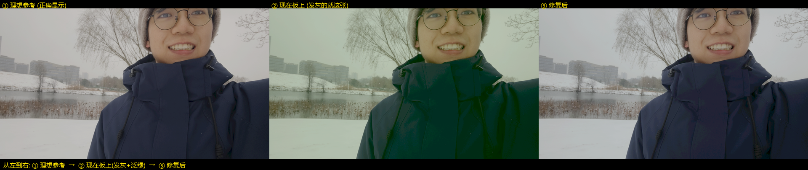
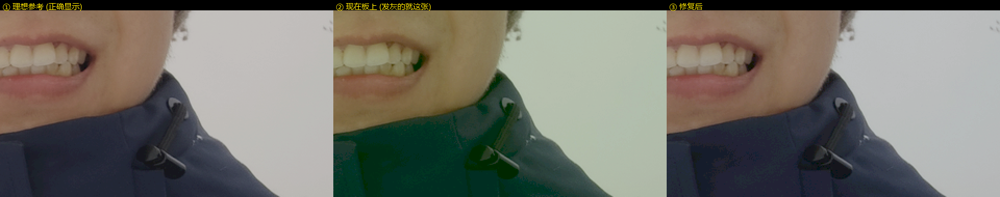

# 原图档"发灰"根因与修复（黑电平挪到 AWB 之前）

> 日期：2026-10-24
> 改动文件：`user_source/hdl_source/awb.v`、`user_source/hdl_source/gamma_lut.v`
> 新增工具：`tools/wb_tune/`（逐位模型 + 图片对比 + ModelSim TB + 实测判据脚本）
> 仿真：ModelSim 10.4，`tb_wb_gray` **PASS**（32 点逐位一致）

---

## 1. 一句话结论

**不是白平衡没做好，是"黑电平扣错了地方"。**

黑电平（传感器盖镜头时的暗底，实测 8bit 域 ≈ **12 LSB**）原本留在 AWB 的输入里，
被两件事同时坑了：

1. 它进了 AWB 的**帧统计量** → 灰世界要的 `G/R`、`G/B` 比值被一个常数压向 1
   → 算出来的增益**恒偏小** → 被"安全走廊"钳在下沿 → AWB 实际上**从来没有真正收敛过**
   → 画面永远是"未校正"的颜色：**偏绿、低饱和**（这就是"发灰"）；
2. 它又被 R/B 增益**一起放大**（×1.25·Kr、×1.25·Kb），到 `gamma_lut.v` 再按
   12/21/33 去扣，**扣不干净** → 纯黑被 γ2.2 抬成 34/255 的灰。

所以「发灰」这个现象里，**约 4/5 是黑电平造成的，1/5 才是白平衡的账**——
而白平衡之所以做不好，根子还是同一个黑电平。

---

## 2. 先分清两种病：发灰 ≠ 偏色

| 屏上表现 | 是谁的错 | 看哪个指标 |
|---|---|---|
| **像蒙了一层雾**：黑不下去、暗部发白、颜色发闷 | 黑电平 / 伽马 | 暗部占比 `p1(Y)/255` > 0.05，`R/G`、`B/G` **都** < 0.95 |
| **整屏偏色**（偏黄/偏蓝/偏红），但黑是黑的 | 才是白平衡 | `R/G`、`B/G` 有一路明显跑偏 |
| 亮处一片白、没有颜色，灯周围发红 | 高光平抑过度 | `max≥250` 的像素占比大 |

用板上回传的 128×72 帧直接量（`tools/py_recv.bin`，10-13 抓的）：

```
R: mean=123.9   G: mean=132.0   B: mean=126.9
R/G = 0.939     B/G = 0.962        <- 两路都 <1，偏绿
Y: min=82.8  p1=90.0  p50=124.3    <- 暗部占比 0.35，黑抬得很高
sat(有光像素) = 0.092              <- 饱和度极低
过曝像素占比  = 0.0%               <- 不是过曝，是高光被压平
```

`R/G < B/G < 1` 这个顺序本身就是指纹：旧链路里 R 欠校正 5.5%、B 欠校正 14%，
R 欠得更多 → R 最暗。**实测与机理完全对得上。**

---

## 3. 根因量化（全部可用代码算式复现）

### 3.1 黑电平在 AWB 输出域的真身

```
awb.v  :  G_out = min(255, G + G/4)        = 12 → 15
          R_out = R * gain_r               = 12 → 21   (Kr=1.75)
          B_out = B * gain_b               = 12 → 33   (Kb=2.75)
gamma   :  扣 (21, 12, 33)
残留    :  R 0   G 3   B 0
γ2.2    :  gamma(3) = 34/255
```

**纯黑的显示结果 = RGB(0, 34, 0)** —— 一层 13% 的**暗绿**灰雾。
（走廊跑到上沿 Kr=1.9375/Kb=3.125 时更糟：残差 2/3/4 → 屏上 **(28,34,39)** 的灰蓝。）

### 3.2 黑电平把灰世界比值压扁了多少

AE 的 `TARGET_Y = 50` 调的是 **AWB 输出域**的 Y（`design_top_wrapper.v` 的
`brightness_stats` 取的是 `S_hdmi_out_data`，即过伽马**之前**的数据）。
所以 AWB **输入**域的 Y ≈ 50/1.25 = **40**，其中 12 是黑电平 —— **占 30%**。

逐通道（`demo.py` 用 720P 场景复现）：占 G 的 **19%**、占 B 的 **35%**。

灰世界要 `G/R`、`G/B` 的比值；三通道同加一个正常数，比值必然被压向 1：

| | 想要的增益 | 旧链路实际给的 | 结果 |
|---|---|---|---|
| `Kr = 1.25·G/R` | 1.654 | **1.5625**（钳在走廊下沿） | R 欠 5.5% |
| `Kb = 1.25·G/B` | 2.839 | **2.4375**（钳在走廊下沿） | B 欠 14% |

> 这就是"白平衡没做好"的真相：**不是算法错，是喂给算法的数字里混进了黑电平，
> 算出来的增益恒偏小，然后被走廊钳死，永远停在"少校正一点"的位置。**

### 3.3 为什么影响这么大：γ2.2 是暗部的放大器

`gamma_map(1) = 21`、`gamma_map(3) = 34`、`gamma_map(8) = 53`。
线性域里 **1 个 LSB 的残留**，到屏上就是 20 多级灰度。
所以"扣不干净"这件事在暗部被放大了 5 倍 —— 这正是"发灰"看起来比理论值严重的原因。

---

## 4. 改了什么

### 4.1 `awb.v`：黑电平挪到入口（组合逻辑，0 拍延迟，不动时序）

```verilog
parameter [7:0] PEDESTAL = 8'd12,   // 唯一的黑电平旋钮；设 0 一键回退旧行为

function [7:0] sub_ped;             // x > PEDESTAL ? x-PEDESTAL : 0
    input [7:0] x;
    begin sub_ped = (x > PEDESTAL) ? (x - PEDESTAL) : 8'd0; end
endfunction

wire [7:0] p0_r = sub_ped(I_tdata[16+:8]), p0_g = sub_ped(I_tdata[8+:8]), p0_b = sub_ped(I_tdata[0+:8]);
...                                  // p1/p2/p3 同理
wire [7:0] s_r = p0_r;               // 帧统计量 = 同一份去底数据
```

- **统计和像素走同一份数据**，这是关键：只修像素不修统计，等于没修白平衡。
- 12 个 8bit 饱和减法器，摊在 4 像素×3 通道上，LUT 代价可以忽略，
  **不加寄存器 → `TUSER_LEAD=24` 的零错位架构一点没动。**
- 顺手把 4 个魔数变成了参数（默认值与原值完全一致，综合结果不变）：

| 参数 | 默认 | 作用 |
|---|---|---|
| `PEDESTAL` | 12 | 黑电平（8bit 域） |
| `CORR_R_LO/HI` | 1.5625x / 1.9375x | R 增益安全走廊 |
| `CORR_B_LO/HI` | 2.4375x / 3.125x | B 增益安全走廊 |
| `HALO_ZONE` | 196 | 进平抑区的 G 阈值 |
| `HALO_R_UP` | 16 | 平抑区 R ≤ G + 此值 |
| `HALO_B_DN` | 24 | 平抑区 B ≥ G − 此值 |
| `SPECULAR` | 248 | 判为镜面高光的 G 阈值 |

> 另外修了一个**潜伏 bug**：`target_r/target_b` 原来在声明之前就被赋值
> （TD 能过，ModelSim 按 Verilog-2001 判成隐式线网报错）。声明已上移，功能不变。

### 4.2 `gamma_lut.v`：这里不能再扣了

```verilog
module gamma_lut #(
    parameter [7:0] BLK_G = 8'd0     // 默认 0：黑电平已在 awb.v 扣过
) ( ... );
```

- 变参数而不是删掉，是为了留回退路径：**`awb.v PEDESTAL=0` + 这里 `BLK_G=12` = 旧行为**。
- ⚠ **两个值必须成对设置，不能同时非零**，否则会扣两次、画面直接压黑。

---

## 5. 验证

### 5.1 ModelSim（真 RTL，非模型）

`tools/wb_tune/tb_wb_gray.v`：把 32 个像素连续送 120 帧（每帧 200 拍消隐，
正好触发一次 `vblank_pulse`），等 IIR 收敛后逐点比对。

```
 idx   input     expected  dut       verdict
  0   0c0c0c    000000    000000    OK      <- 传感器黑 -> 纯黑
  1   2e3c20    828477    828477    OK
  3   64aa50    c8e3d6    c8e3d6    OK
 ...                                (32/32 全 OK)
*** TB PASS ***
```

### 5.2 Python 逐位模型 + 720P 实拍场景

`tools/wb_tune/demo.py`（γ 表直接从 `gamma_lut.v` 里解析，不会漂）：

| | 增益 | 暗部最黑 | 对比度 span | ΔRGB vs 理想 |
|---|---|---|---|---|
| 理想参考 | — | (19,22,30) | 160.3 | 0 |
| **旧 RTL** | 1.5625 / 2.4375（钳死） | **(0,39,0) 暗绿** | 157.4 | **12.40 LSB** |
| **修复后** | 1.6523 / 2.8359（走廊内） | **(0,0,0)** | 159.8 | **2.63 LSB** |

平均色差降到原来的 **1/5**，且增益第一次真正落在走廊内部。



> 图注（两张图都是同一顺序，标题栏已标）：
> **① 理想参考** = 正确处理后该有的样子（用来当标尺，板上不会出现这一档）
> → **② 现在板上** = 旧 RTL 的实际效果，**发灰泛绿的就是这张**
> → **③ 修复后** = 本次改动之后。



> 同一处的 2 倍放大：看外套。② 里藏青色变成墨绿、牙齿发黄，③ 里颜色都回来了。

---

## 6. 上板后怎么调（参数速查）

改参数只动 `awb.v` 的 parameter 区，不用碰逻辑。
`tools/wb_tune/measure.py` 可以直接量回传帧，给方向。

| 现象 | 动哪个 | 怎么动 |
|---|---|---|
| 还是有点灰、黑不下去 | `PEDESTAL` | 往**大**调（12→14→16），每步 1~2；过大表现为**墨绿/墨蓝**，且暗部细节被啃掉 |
| 黑已经死黑、暗部细节没了 | `PEDESTAL` | 往**小**调 |
| 黑对了但整体偏绿 | `CORR_R_HI/LO`、`CORR_B_*` | 先看 `measure.py` 的 `R/G`、`B/G`；偏绿说明 R、B 欠 → 走廊**整体上移** |
| 整体偏黄/偏品 | 同上 | 走廊整体**下移** |
| 台灯、白纸偏白没颜色 | `HALO_ZONE` | 196 → 220~240（越大越保留高光颜色） |
| 灯周围还有红圈 | `HALO_ZONE` / `HALO_R_UP` | 阈值调小、`HALO_R_UP` 调小 |
| 高光边缘又开始发糊 | `SPECULAR` | 248 → 252（少触发"强行纯白"） |

**实测黑电平的正确方法**：盖住镜头（或对着纯黑布），切到原图档，
看 `measure.py` 报的 `最暗像素 Y`。目标：**Y = 0**。
现在（`PEDESTAL=12`）如果报 Y≈34 且偏绿，说明实际黑电平比 12 大，按 3.1 的公式
`delta = 255·(Y/255)^2.2 / K` 估一下就再加几级。

---

## 7. 副作用 / 连带变化（必须知道）

1. **自动曝光会自己往上走一格。**
   AE 调的是 AWB 输出域的 Y。黑电平不再算"信号"以后，AE 会多曝光约
   12/1.25 ≈ 10 LSB，把亮度补回来。等价于**有效曝光 +40%**（约 +3 dB），
   噪声会变小——这是白赚的。上板后**不要**再手动加增益。
2. **DDR 里的亮度整体下了 12·Kr LSB**（R 约 21、G 约 15、B 约 33）。
   8bit 通路完全够用，但若以后有人再叠一级大增益，注意别提前撞 255。
3. **色度降噪 `chroma_nr` 没动**，仍是 4 抽头水平色度平均（会吃掉一点点饱和）。
   如果修完还嫌"不够艳"，那是它的账，不是白平衡的——不建议现在动它
   （会改 22 拍对齐）。
4. **`src/awb.v` 是另一份旧变体，不参与 TD 综合**（`.al` 里编的是
   `user_source/hdl_source/awb.v`）。别改错文件。

---

## 8. 复现命令

```powershell
cd tools\wb_tune

# 1. 黑电平算术 + 灰阶响应（不需要图片，先把机理看清楚）
python probe.py

# 2. 720P 场景 before/after 图 + 指标
python demo.py            # -> out/before_after.png, out/shadow_zoom.png, out/grey_ramp.png

# 3. 生成 TB 向量 + 跑 ModelSim
python gen_awb_vectors.py
vlib msim/work; vmap work msim/work
vlog -work work <hdl>\awb.v <hdl>\divider_seq.v <hdl>\gamma_lut.v tb_wb_gray.v
vsim -c -do "run -all; quit -f" work.tb_wb_gray

# 4. 量一张板上回传的帧
python measure.py ..\py_recv.bin
```
